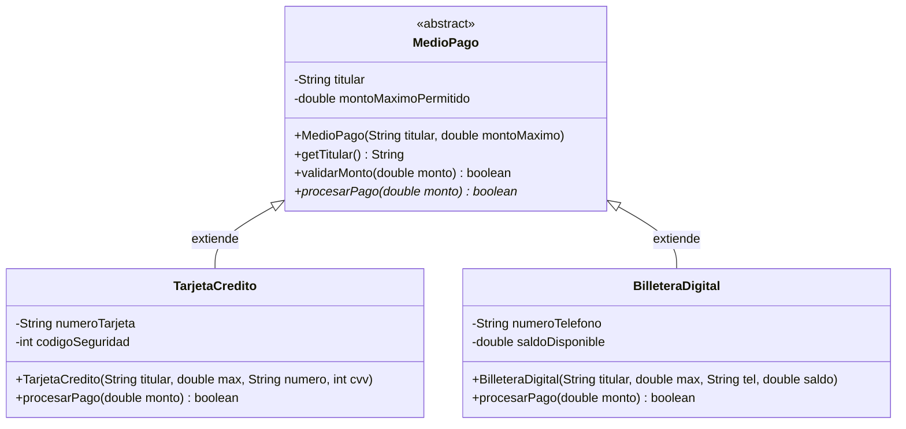

# Abstracción

> **En una frase:** la abstracción consiste en capturar únicamente las características y comportamientos esenciales de una entidad para el problema que se resuelve, suprimiendo los detalles accidentales o innecesarios para reducir la complejidad mental del sistema.

En las lecciones anteriores aprendimos a crear objetos ([Clases y objetos](/lecciones/clases-objetos/)), a controlar su construcción ([Atributos, métodos y constructores](/lecciones/atributos-metodos-y-constructores/)) y a proteger su estado ([Encapsulamiento](/lecciones/encapsulamiento/)). Sin embargo, antes de poder proteger un dato, debemos responder una pregunta de diseño previa y crucial: *¿qué datos y operaciones pertenecen verdaderamente al objeto en el contexto de nuestra aplicación, y cuáles debemos ignorar deliberadamente?* En esta lección exploraremos la **abstracción**, tanto como principio fundamental de modelado como mediante el uso de **clases y métodos abstractos** en Java.

## ¿Qué aprenderás?

Al finalizar esta lección podrás:

- Explicar la diferencia entre abstracción (enfocada en el *qué*) y encapsulamiento (enfocado en el *cómo*).
- Seleccionar los atributos y métodos estrictamente pertinentes para una entidad según el dominio del problema.
- Declarar clases abstractas con la palabra reservada `abstract` y comprender por qué no pueden ser instanciadas directamente con `new`.
- Definir métodos abstractos para obligar a las clases derivadas a proveer implementaciones concretas.
- Diseñar jerarquías base que combinen código reutilizable común con operaciones especializadas.

---

## 1. El problema que queremos resolver

Cuando una persona comienza a modelar entidades del mundo real en código, suele caer en dos trampas opuestas pero igualmente destructivas:

1. **La trampa del hiperrealismo:** intentar copiar la realidad de forma exhaustiva. Si modelas un `Usuario` para un sistema de biblioteca, no necesitas registrar su tipo de sangre, su color de ojos o la talla de su calzado. Incluir detalles irrelevantes sobrecarga las clases, multiplica el consumo de memoria y contamina la lógica de la aplicación con datos sin propósito.
2. **La trampa del concepto genérico incompleto:** imagina una pasarela de pagos que procesa cobros con distintos medios: tarjeta de crédito, PayPal y transferencia bancaria. Todos los medios de pago cobran dinero, pero no existe en la vida real un *«Medio de Pago genérico»* que puedas cobrar sin saber el mecanismo específico.
   - Si creas una clase ordinaria `MedioPago` con un método `procesarPago()`, ¿qué código escribes dentro? ¿Cómo evitas que un programador haga por descuido `new MedioPago()` e intente cobrar con algo que no existe?

La **abstracción** resuelve ambos dilemas: nos enseña qué detalles omitir al diseñar nuestras clases y nos provee de herramientas de lenguaje (como `abstract`) para definir plantillas conceptuales que no pueden ser creadas en el vacío.

---

## 2. Explicación intuitiva

Para entender la abstracción, piensa en el **mapa del metro de una gran ciudad**:


- Un mapa de metro no muestra las curvas exactas del túnel subterráneo, ni la profundidad en metros, ni el tipo de roca que rodea las vías, ni los edificios que están en la superficie.
- Si el mapa incluyera todos esos detalles geológicos y urbanísticos reales, sería **imposible de leer** para un pasajero apurado en una estación.
- El mapa selecciona exclusivamente lo indispensable para viajar: **el nombre de las estaciones, las líneas de color y los puntos de transbordo**. Esa simplificación selectiva y útil es una **abstracción**.

En Java ocurre lo mismo con las **clases abstractas**:
- *"Figura Geométrica"* o *"Animal"* son conceptos abstractos. Puedes ver un perro, un gato o un círculo, pero nunca verás caminando por la calle a un *"Animal genérico"* sin especie definida.
- La clase abstracta define las reglas del juego que todos comparten (por ejemplo, todos los animales emiten sonido o todas las figuras calculan su área), pero delega la forma exacta de hacerlo en cada especie o figura concreta.

---

## 3. Definición técnica

### 3.1. Abstracción vs Encapsulamiento

Es muy común confundir estos dos pilares de la POO. La diferencia es nítida cuando los miras desde la perspectiva del diseño:

- **Abstracción:** responde a la pregunta **«¿Qué hace el objeto y qué representa hacia el exterior?»**. Se enfoca en el comportamiento visible y en simplificar la realidad seleccionando únicamente lo esencial para el problema.
- **Encapsulamiento:** responde a la pregunta **«¿Cómo lo hace internamente y cómo se protegen sus datos?»**. Se enfoca en ocultar los detalles de implementación y asegurar que el estado no sea corrompido desde afuera.

> **Regla nemotécnica:** la abstracción te muestra los botones del control remoto del televisor (encender, volumen, canal); el encapsulamiento encierra los chips y circuitos dentro de la carcasa plástica para que no los toques con los dedos.

### 3.2. Clases abstractas en Java (`abstract class`)

Una **clase abstracta** es una clase que no puede ser instanciada directamente (no se puede usar `new` con ella). Se declara anteponiendo la palabra clave `abstract`:

```java
public abstract class MedioPago {
    // Código de la clase
}
```

**Características fundamentales:**
- **No instanciable:** intentar hacer `new MedioPago()` produce un error inmediato del compilador: *"MedioPago is abstract; cannot be instantiated"*.
- **Reutilización de estado y código:** a diferencia de lo que veremos más adelante con las interfaces, una clase abstracta **sí puede tener atributos de instancia**, constructores completos y métodos ordinarios con código implementado que las subclases heredan y aprovechan.
- **Constructores en clases abstractas:** aunque no puedas instanciarlas directamente, sus constructores existen para ser invocados por las subclases (usando `super(...)`) al inicializar los atributos base compartidos.

### 3.3. Métodos abstractos (`abstract`)

Un **método abstracto** es una declaración de operación que define el nombre, los parámetros y el tipo de retorno, pero **carece de cuerpo** (no tiene llaves `{}` ni código). Termina directamente con un punto y coma `;`:

```java
public abstract boolean procesarPago(double monto);
```

**Reglas indispensables de los métodos abstractos:**
- Solo pueden declararse dentro de una clase que también esté marcada como `abstract`.
- Representan un **contrato u obligación estricta**: cualquier clase concreta que herede de esta clase abstracta **debe proveer obligatoriamente una implementación** con cuerpo para todos los métodos abstractos heredados. Si no lo hace, esa subclase también deberá ser declarada como abstracta.

---

## 4. Representación visual

Observa cómo una clase abstracta define la estructura compartida y delega la ejecución especializada en sus clases concretas:



**Cómo interpretar el diagrama:**
- `MedioPago` es una clase abstracta (`<<abstract>>`). Posee código real reutilizable (`validarMonto`) y un método abstracto obligatorio (`procesarPago*`).
- `TarjetaCredito` y `BilleteraDigital` son clases concretas: heredan los atributos del titular y completan la lógica de `procesarPago` según su propia naturaleza.

---

## 5. Ejemplo inicial: el peligro de las clases concretas vacías

Observa el diseño defectuoso sin abstracción:

```java
// Mal diseño: clase concreta que no debería poder crearse por sí sola
class MedioPagoDefectuoso {
    String titular;

    MedioPagoDefectuoso(String titular) {
        this.titular = titular;
    }

    // ¿Qué hace este método? No hay forma lógica de saberlo
    boolean procesarPago(double monto) {
        System.out.println("Error: no se sabe cómo cobrar con un medio genérico.");
        return false;
    }
}

public class SistemaInseguro {
    public static void main(String[] args) {
        // Nada impide crear un medio de pago que no existe en la realidad:
        MedioPagoDefectuoso medioFantasma = new MedioPagoDefectuoso("Carlos");
        medioFantasma.procesarPago(100.0); // Falla en ejecución silenciosamente
    }
}
```

### ¿Qué problemas observamos?

1. **Permisividad peligrosa:** el compilador permite crear `new MedioPagoDefectuoso()`, lo cual carece de sentido en el negocio.
2. **Código de relleno inútil:** el método `procesarPago` contiene texto genérico de error porque no tiene forma real de ejecutarse.
3. **Falta de exigencia:** si un nuevo programador crea una subclase `TransferenciaBancaria`, nada le obliga a implementar el cobro; si olvida sobreescribir el método, el compilador no le avisará del fallo.

---

## 6. Aplicación del concepto

Transformemos la jerarquía aplicando `abstract class` y `abstract method`. Ahora el sistema será imposible de utilizar erróneamente:

```java
// 1. Clase abstracta: plantilla conceptual y base de reutilización
abstract class MedioPago {

    private final String titular;
    private final double limitePorTransaccion;

    // Constructor para que las subclases inicialicen el estado común
    public MedioPago(String titular, double limitePorTransaccion) {
        if (titular == null || titular.trim().isEmpty()) {
            throw new IllegalArgumentException("El titular no puede ser vacío.");
        }
        this.titular = titular;
        this.limitePorTransaccion = (limitePorTransaccion > 0) ? limitePorTransaccion : 0.0;
    }

    public String getTitular() {
        return this.titular;
    }

    public double getLimitePorTransaccion() {
        return this.limitePorTransaccion;
    }

    // Método concreto común: lógica idéntica para todos los medios de pago
    public boolean validarLimite(double monto) {
        if (monto <= 0) {
            System.out.println("Monto inválido para " + this.titular + ": debe ser positivo.");
            return false;
        }
        if (monto > this.limitePorTransaccion) {
            System.out.println("Transacción rechazada: $" + monto 
                + " excede el límite permitido de $" + this.limitePorTransaccion);
            return false;
        }
        return true;
    }

    // Método abstracto: CADA medio de pago DEBE implementar cómo se cobra
    public abstract boolean procesarPago(double monto);
}

// 2. Subclase concreta: Tarjeta de Crédito
class TarjetaCredito extends MedioPago {

    private final String ultimosCuatroDigitos;
    private double cupoDisponible;

    public TarjetaCredito(String titular, double limitePorTransaccion, 
                          String ultimosCuatroDigitos, double cupoDisponible) {
        super(titular, limitePorTransaccion); // Invoca al constructor de la clase abstracta
        this.ultimosCuatroDigitos = ultimosCuatroDigitos;
        this.cupoDisponible = cupoDisponible;
    }

    // Implementación OBLIGATORIA del método abstracto
    @Override
    public boolean procesarPago(double monto) {
        if (!validarLimite(monto)) {
            return false;
        }
        if (monto > this.cupoDisponible) {
            System.out.println("Tarjeta [**** " + this.ultimosCuatroDigitos + "]: cupo insuficiente.");
            return false;
        }

        this.cupoDisponible -= monto;
        System.out.println("Pago exitoso de $" + monto + " con Tarjeta [**** " 
            + this.ultimosCuatroDigitos + "]. Cupo restante: $" + this.cupoDisponible);
        return true;
    }
}

// 3. Subclase concreta: Billetera Móvil (por ejemplo, pago con número telefónico)
class BilleteraMovil extends MedioPago {

    private final String numeroCelular;
    private double saldoMonedero;

    public BilleteraMovil(String titular, double limitePorTransaccion, 
                          String numeroCelular, double saldoMonedero) {
        super(titular, limitePorTransaccion);
        this.numeroCelular = numeroCelular;
        this.saldoMonedero = saldoMonedero;
    }

    // Implementación OBLIGATORIA del método abstracto
    @Override
    public boolean procesarPago(double monto) {
        if (!validarLimite(monto)) {
            return false;
        }
        if (monto > this.saldoMonedero) {
            System.out.println("Billetera [" + this.numeroCelular + "]: saldo insuficiente.");
            return false;
        }

        this.saldoMonedero -= monto;
        System.out.println("Cobro aprobado de $" + monto + " en Billetera Móvil [" 
            + this.numeroCelular + "]. Saldo actual: $" + this.saldoMonedero);
        return true;
    }
}

public class PasarelaPagos {

    public static void main(String[] args) {
        // La siguiente línea NO compila si se descomenta:
        // MedioPago pago = new MedioPago("Carlos", 500.0); // Error: MedioPago is abstract

        // Creamos instancias de clases concretas:
        TarjetaCredito visa = new TarjetaCredito("Carlos Ruiz", 1000.0, "4512", 1500.0);
        BilleteraMovil nequi = new BilleteraMovil("Elena Blanco", 300.0, "3109876543", 250.0);

        System.out.println("--- Procesando cobro 1 (Visa) ---");
        visa.procesarPago(600.0);

        System.out.println("\n--- Procesando cobro 2 (Visa excede límite) ---");
        visa.procesarPago(1200.0); // Límite es 1000

        System.out.println("\n--- Procesando cobro 3 (Billetera Móvil) ---");
        nequi.procesarPago(150.0);

        System.out.println("\n--- Procesando cobro 4 (Billetera Móvil sin saldo) ---");
        nequi.procesarPago(200.0); // Solo le quedaban 100
    }
}
```

### Explicación del código

- **`abstract class MedioPago`:** garantiza que nadie pueda instanciar un medio de pago incompleto. Concentra la lógica común de validación de límites (`validarLimite`) para evitar duplicarla.
- **`public abstract boolean procesarPago(double monto)`:** no tiene cuerpo en la clase abstracta. Funciona como una promesa: *"toda entidad que pretenda ser un medio de pago debe decirme con exactitud cómo descuenta el dinero"*.
- **`super(titular, limitePorTransaccion)`:** permite a las clases hijas reutilizar la validación y el almacenamiento del estado de la superclase abstracta.
- **`@Override`:** anotación que confirma al compilador que estamos cumpliendo con la implementación del método abstracto.

### Cómo ejecutar el ejemplo

1. Guarda el código en un archivo llamado `PasarelaPagos.java`.
2. Compila con:
   ```bash
   javac PasarelaPagos.java
   ```
3. Ejecuta con:
   ```bash
   java PasarelaPagos
   ```

**Resultado esperado:**

```text
--- Procesando cobro 1 (Visa) ---
Pago exitoso de $600.0 con Tarjeta [**** 4512]. Cupo restante: $900.0

--- Procesando cobro 2 (Visa excede límite) ---
Transacción rechazada: $1200.0 excede el límite permitido de $1000.0

--- Procesando cobro 3 (Billetera Móvil) ---
Cobro aprobado de $150.0 en Billetera Móvil [3109876543]. Saldo actual: $100.0

--- Procesando cobro 4 (Billetera Móvil sin saldo) ---
Billetera [3109876543]: saldo insuficiente.
```

---

## 7. Comparación entre enfoques

| Criterio | Clase Concreta Ordinaria | Clase Abstracta (`abstract class`) |
| :--- | :--- | :--- |
| **Instanciación** | Permite crear objetos con `new`. | **No** permite instanciación directa. |
| **Métodos abstractos** | No puede contener métodos abstractos. | Puede contener métodos abstractos y métodos concretos. |
| **Propósito de diseño** | Representar entidades completas y específicas del dominio. | Definir un modelo conceptual base y forzar un contrato a sus derivadas. |
| **Obligación para subclases** | Las subclases deciden si sobreescriben o no los métodos. | Las subclases concretas **están obligadas** a implementar los métodos abstractos. |

---

## 8. ¿Cuándo utilizar este concepto?

### Casos en los que resulta indispensable

- **Cuando existe un concepto general que agrupa a múltiples variantes especializadas:** (vehículos, documentos, notificaciones, sensores, figuras geométricas).
- **Para compartir código base y estado común:** cuando todas las variantes necesitan los mismos atributos (como `titular` o `id`) y los mismos métodos de soporte, pero tienen una operación central que difiere en cada una.
- **Para evitar la creación accidental de entidades incompletas:** si la clase base por sí misma no tiene suficiente significado para operar en el negocio.

### Cuándo no utilizarlo o tener precaución

- **Abstracción prematura:** no crees clases abstractas si solo vas a tener una única clase concreta en todo tu sistema. Espera a que aparezca una segunda o tercera variante real antes de generalizar.
- **Jerarquías profundas y artificiales:** evita encadenar clases abstractas multinivel (`abstract A -> abstract B -> abstract C -> D`) si no hay una ganancia arquitectónica nítida. Esto genera complejidad accidental.

---

## 9. Errores frecuentes

### Error 1: Intentar instanciar directamente una clase abstracta

**Qué sucede:**
```java
abstract class Animal {}
// En otra parte:
Animal a = new Animal(); // Error de compilación: Animal is abstract; cannot be instantiated
```
**Por qué ocurre:** una clase abstracta es por definición un concepto incompleto.  
**Cómo evitarlo:** instancia una clase concreta que extienda de ella (`new Perro()`).

---

### Error 2: Declarar un método abstracto con llaves de código `{}`

**Qué sucede:**
```java
abstract class Dispositivo {
    abstract void encender() { } // Error: abstract methods cannot have a body
}
```
**Por qué ocurre:** los métodos abstractos solo declaran la firma; no tienen implementación.  
**Cómo evitarlo:** termina la declaración con punto y coma: `abstract void encender();`.

---

### Error 3: No implementar todos los métodos abstractos en una subclase concreta

**Qué sucede:**
```java
abstract class Forma {
    abstract double calcularArea();
}

class Triangulo extends Forma {
    // Si olvidas escribir calcularArea() en Triangulo:
    // Error: Triangulo is not abstract and does not override abstract method calcularArea() in Forma
}
```
**Cómo evitarlo:** implementa todos los métodos abstractos pendientes o declara la subclase también como `abstract`.

---

## 10. Ejercicio práctico

### Enunciado

Diseña una jerarquía para una estación meteorológica que procesa diferentes tipos de sensores ambientales mediante abstracción:

**Requisitos:**

1. **Clase abstracta `SensorAmbiental`:**
   - Atributos privados: `identificador` (`String`) y `ubicacion` (`String`).
   - Constructor protegido que reciba ambos atributos y valide que no sean nulos ni vacíos.
   - Métodos concretos: `getIdentificador()`, `getUbicacion()` y `mostrarIdentificacion()` que imprima `[ID] Sensor en UBICACION`.
   - **Métodos abstractos:**
     - `abstract double leerValor();` (obtiene la lectura numérica del sensor).
     - `abstract String getUnidadMedida();` (obtiene el símbolo o nombre de la unidad, por ejemplo `°C` o `%`).
     - `abstract boolean estaEnRangoAlerta();` (evalúa si la lectura actual supera los umbrales seguros).
2. **Subclase concreta `SensorTemperatura`:**
   - Atributo privado adicional: `temperaturaActual` (`double`).
   - Implementa los métodos abstractos:
     - Unidad de medida: `"°C"`.
     - Rango de alerta: retorna `true` si la temperatura es menor a `0.0 °C` o superior a `40.0 °C`.
3. **Subclase concreta `SensorHumedad`:**
   - Atributo privado adicional: `porcentajeHumedad` (`double`).
   - Implementa los métodos abstractos:
     - Unidad de medida: `"%"`.
     - Rango de alerta: retorna `true` si la humedad es menor al `20.0 %` o superior al `85.0 %`.

---

### Pistas

<details>
<summary>Mostrar pistas</summary>

- En `SensorTemperatura`, el constructor debe llamar a `super(identificador, ubicacion);` e inicializar `this.temperaturaActual`.
- En `SensorHumedad`, el constructor debe hacer lo mismo con `this.porcentajeHumedad`.
- En una clase ejecutable con `main`, crea un sensor de temperatura y uno de humedad e invoca sus métodos para comprobar su funcionamiento.

</details>

---

### Solución propuesta

<details>
<summary>Mostrar solución y explicación</summary>

```java
abstract class SensorAmbiental {

    private final String identificador;
    private final String ubicacion;

    protected SensorAmbiental(String identificador, String ubicacion) {
        if (identificador == null || identificador.trim().isEmpty()) {
            throw new IllegalArgumentException("Identificador inválido.");
        }
        if (ubicacion == null || ubicacion.trim().isEmpty()) {
            throw new IllegalArgumentException("Ubicación inválida.");
        }
        this.identificador = identificador;
        this.ubicacion = ubicacion;
    }

    public String getIdentificador() {
        return this.identificador;
    }

    public String getUbicacion() {
        return this.ubicacion;
    }

    public void emitirReporte() {
        double valor = leerValor();
        String unidad = getUnidadMedida();
        boolean alerta = estaEnRangoAlerta();

        System.out.println("Sensor [" + this.identificador + " - " + this.ubicacion + "]: " 
            + valor + " " + unidad + (alerta ? " -> ¡ALERTA AMBIENTAL DETECTADA!" : " -> Normal"));
    }

    // Métodos que deben definir las subclases:
    public abstract double leerValor();
    public abstract String getUnidadMedida();
    public abstract boolean estaEnRangoAlerta();
}

class SensorTemperatura extends SensorAmbiental {

    private double temperaturaActual;

    public SensorTemperatura(String identificador, String ubicacion, double temperaturaActual) {
        super(identificador, ubicacion);
        this.temperaturaActual = temperaturaActual;
    }

    public void actualizarTemperatura(double nuevaTemperatura) {
        this.temperaturaActual = nuevaTemperatura;
    }

    @Override
    public double leerValor() {
        return this.temperaturaActual;
    }

    @Override
    public String getUnidadMedida() {
        return "°C";
    }

    @Override
    public boolean estaEnRangoAlerta() {
        return this.temperaturaActual < 0.0 || this.temperaturaActual > 40.0;
    }
}

class SensorHumedad extends SensorAmbiental {

    private double porcentajeHumedad;

    public SensorHumedad(String identificador, String ubicacion, double porcentajeHumedad) {
        super(identificador, ubicacion);
        this.porcentajeHumedad = porcentajeHumedad;
    }

    public void actualizarHumedad(double nuevaHumedad) {
        this.porcentajeHumedad = nuevaHumedad;
    }

    @Override
    public double leerValor() {
        return this.porcentajeHumedad;
    }

    @Override
    public String getUnidadMedida() {
        return "%";
    }

    @Override
    public boolean estaEnRangoAlerta() {
        return this.porcentajeHumedad < 20.0 || this.porcentajeHumedad > 85.0;
    }
}

public class EstacionClimatica {

    public static void main(String[] args) {
        SensorTemperatura termometro = new SensorTemperatura("TEMP-01", "Invernadero Norte", 24.5);
        SensorHumedad higrometro = new SensorHumedad("HUM-02", "Invernadero Norte", 18.0);

        // Emitimos reportes usando la lógica base común
        termometro.emitirReporte();
        higrometro.emitirReporte(); // Alerta: 18% < 20%

        System.out.println("\n--- Se actualizan lecturas climáticas ---");
        termometro.actualizarTemperatura(42.0); // Supera 40 °C
        higrometro.actualizarHumedad(55.0);     // Normal

        termometro.emitirReporte(); // Alerta
        higrometro.emitirReporte(); // Normal
    }
}
```

**Resultado esperado:**

```text
Sensor [TEMP-01 - Invernadero Norte]: 24.5 °C -> Normal
Sensor [HUM-02 - Invernadero Norte]: 18.0 % -> ¡ALERTA AMBIENTAL DETECTADA!

--- Se actualizan lecturas climáticas ---
Sensor [TEMP-01 - Invernadero Norte]: 42.0 °C -> ¡ALERTA AMBIENTAL DETECTADA!
Sensor [HUM-02 - Invernadero Norte]: 55.0 % -> Normal
```

**Explicación:**  
La clase abstracta `SensorAmbiental` implementa el método `emitirReporte()`, el cual orquesta las llamadas a los métodos abstractos `leerValor()`, `getUnidadMedida()` y `estaEnRangoAlerta()`. Aunque la clase abstracta no sabe qué tipo de sensor se ejecutará en el futuro, puede coordinar su comportamiento con total seguridad gracias a la abstracción.

</details>

---

## 11. Resumen de la lección

- **Propósito:** la abstracción filtra los detalles accidentales y captura lo esencial de un problema para mantener el diseño simple y comprensible.
- **Diferencia clave:** la abstracción define el *qué*; el encapsulamiento protege y oculta el *cómo*.
- **Clases abstractas:** estructuras base que no pueden instanciarse directamente, ideales para compartir código y definir contratos.
- **Métodos abstractos:** operaciones sin cuerpo que obligan a las subclases a proporcionar su propia implementación especializada.

---

## 12. Comprueba tu comprensión

1. ¿Por qué una clase abstracta no puede ser instanciada con el operador `new`?
2. Si una clase abstracta no se puede instanciar, ¿para qué sirve que tenga constructores?
3. ¿Cuál es la diferencia fundamental entre el propósito de la abstracción y el del encapsulamiento?
4. ¿Qué ocurre si una clase concreta hereda de una clase abstracta pero no implementa uno de sus métodos abstractos?

---

## 13. Continúa aprendiendo

- **Lección anterior:** [Encapsulamiento](/lecciones/encapsulamiento/)
- **Siguiente lección recomendada:** [Herencia](/lecciones/herencia/) — donde aprenderás a reutilizar código y modelar relaciones de especialización jerárquica con `extends` y `super`.
- **Ruta de aprendizaje:** [Fundamentos de POO](/categorias/fundamentos-poo/)

---

## 14. Fuentes y lecturas recomendadas

- Oracle. *The Java Tutorials: Abstract Methods and Classes*. [docs.oracle.com/javase/tutorial/java/IandI/abstract.html](https://docs.oracle.com/javase/tutorial/java/IandI/abstract.html)
- Cay S. Horstmann. *Core Java Volume I: Fundamentals* (12th Edition). Pearson, 2022. Capítulo 5: «Abstract Classes».
- Grady Booch, Robert A. Maksimchuk, Michael W. Engle, Bobbi J. Young, Jim Conallen, Kelli A. Houston. *Object-Oriented Analysis and Design with Applications* (3rd Edition). Addison-Wesley, 2007. Capítulo 2: «Elements of the Object Model — Abstraction».
