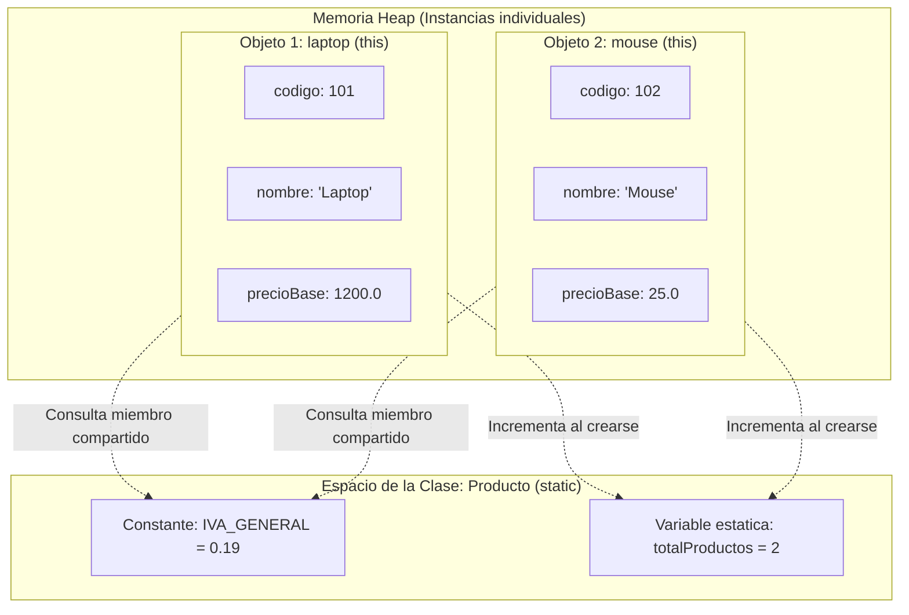

# Atributos, métodos y constructores

> **En una frase:** los atributos determinan el estado de un objeto, los métodos definen sus capacidades y los constructores aseguran su correcto nacimiento; herramientas como `this`, `static`, `final` y la sobrecarga permiten afinar su comportamiento y ciclo de vida.

En la lección anterior ([Clases y objetos](/lecciones/clases-objetos/)) aprendimos qué es una clase y cómo crear instancias independientes en memoria. En esta lección profundizaremos en el diseño interno de esas clases: cómo garantizar que un objeto nunca nazca en un estado incompleto, cómo distinguir la información propia de cada instancia de la información compartida a nivel de clase, y cómo ofrecer múltiples formas de construir y operar con nuestros objetos.

## ¿Qué aprenderás?

Al finalizar esta lección podrás:

- Explicar la diferencia entre variables de instancia, variables locales y miembros de clase (`static`).
- Implementar constructores parametrizados y aprovechar la sobrecarga (*overloading*) de constructores y métodos.
- Comprender el ciclo de inicialización de atributos y el rol de los valores predeterminados de Java.
- Emplear la palabra clave `this` para desambiguar variables y encadenar constructores de forma limpia.
- Declarar constantes de aplicación inmutables mediante la combinación `static final`.

---

## 1. El problema que queremos resolver

Cuando una clase comienza a modelar un problema real, surgen necesidades esenciales de diseño:

1. **Objetos a medio construir:** si permitimos crear un objeto sin obligar a definir sus datos vitales (por ejemplo, un producto sin precio o un boleto sin pasajero), cualquier método que intente operar con esos datos incompletos provocará cálculos erróneos o fallos en ejecución (`NullPointerException`).
2. **Diversidad al instanciar:** en muchos dominios no siempre disponemos de toda la información al crear un elemento. A veces un cliente registra un producto con precio y descuento promocional; otras veces el producto no tiene descuento inicial. ¿Cómo permitimos ambas opciones sin duplicar clases ni crear métodos extraños?
3. **Datos duplicados innecesariamente:** si vendemos 10.000 productos en un supermercado y todos aplican el mismo porcentaje de impuesto (IVA), ¿tiene sentido que cada uno de los 10.000 objetos guarde una copia idéntica de ese porcentaje en la memoria de la computadora?
4. **Colisión de nombres:** al recibir datos en un constructor o método, lo más intuitivo es llamar al parámetro con el mismo nombre que el atributo (por ejemplo, `precio`). ¿Cómo sabe Java si nos referimos al dato que viene de afuera o a la variable interna del objeto?

Resolver estas cuatro situaciones requiere dominar el uso de **constructores bien definidos**, la palabra clave **`this`**, la **sobrecarga** y los miembros **`static`**.

---

## 2. Explicación intuitiva

Para comprender estas piezas, imaginemos la fabricación de automóviles en una planta automotriz:


- **El constructor es la línea de ensamblaje:** nadie compra un coche que sale de fábrica sin motor ni ruedas. El constructor es el protocolo de montaje obligatorio: exige las partes indispensables para que el coche salga a la calle listo para funcionar.
- **La sobrecarga de constructores son los paquetes de fábrica:** puedes pedir el modelo básico (motor y color estándar) o el modelo prémium (motor, color personalizado y techo corredizo). Sigue siendo el mismo modelo de coche, pero con diferentes opciones iniciales de ensamblaje.
- **La referencia `this` es el pronombre "mi propio":** cuando un coche frena, no activa los frenos de los coches de los vecinos; activa *sus propios* frenos. Dentro del coche, `this` significa *"este automóvil en el que me encuentro ahora mismo"*.
- **Los miembros `static` son la pizarra de la fábrica:** la planta tiene un panel central que indica la cantidad total de coches fabricados hoy o la velocidad máxima permitida por ley en la ciudad. Esa información no le pertenece a un solo coche en particular: es compartida y consultada por todos, existiendo a nivel de la fábrica (la clase).
- **El modificador `final` es el número de chasis:** una vez grabado al nacer el vehículo, es una constante inmutable que nadie puede alterar.

---

## 3. Definición técnica

### 3.1. Atributos de instancia y valores predeterminados

Los **atributos de instancia** son variables declaradas dentro del cuerpo de la clase pero fuera de cualquier método. Cada objeto creado a partir de la clase posee su propia copia en la memoria *Heap*.

En Java, si un atributo de instancia no se inicializa de forma explícita, el compilador y la máquina virtual le asignan automáticamente un **valor predeterminado**:

| Tipo de dato | Valor predeterminado |
| :--- | :--- |
| Tipos numéricos enteros (`byte`, `short`, `int`, `long`) | `0` |
| Tipos de coma flotante (`float`, `double`) | `0.0` |
| Booleano (`boolean`) | `false` |
| Carácter (`char`) | `'\u0000'` (carácter nulo) |
| Referencias a objetos (`String`, clases personalizadas, arreglos) | `null` |

> **Importante:** las variables declaradas dentro de métodos (variables locales) **no** reciben valores predeterminados. El compilador de Java emitirá un error si intentas leer una variable local sin antes haberle asignado un valor.

### 3.2. Métodos de instancia y parámetros

Un método de instancia define una acción que puede realizar cualquier objeto de la clase. Su anatomía consta de:

- **Tipo de retorno:** indica el tipo de dato que el método entrega a quien lo llamó (`int`, `double`, `String`, etc.). Si la operación no devuelve ningún valor, se utiliza la palabra clave `void`.
- **Nombre del método:** por convención en Java, se escribe en formato `camelCase` (por ejemplo, `calcularPrecioFinal`).
- **Lista de parámetros:** variables que recibe el método entre paréntesis, separadas por comas, que actúan como datos de entrada locales para la operación.
- **Cuerpo del método:** bloque delimitado por llaves `{}` con las instrucciones a ejecutar.

### 3.3. La palabra clave `this`

`this` es una referencia implícita disponible dentro de cualquier constructor o método de instancia que apunta al **objeto receptor actual** (la instancia sobre la cual se está ejecutando el código).

Cumple dos funciones primordiales:

1. **Desambiguar nombres (sombreado de variables o *shadowing*):** cuando un parámetro tiene el mismo nombre que un atributo, el parámetro oculta al atributo dentro del bloque. Para acceder al atributo de la instancia se antepone `this.`:
   ```java
   class Producto {
       String nombre;

       Producto(String nombre) {
           this.nombre = nombre; // this.nombre es el atributo; nombre es el parámetro
       }
   }
   ```
2. **Invocar constructores alternativos (`this(...)`):** permite que un constructor delegue parte del trabajo a otro constructor de la misma clase, reduciendo la duplicación de código. Debe ser obligatoriamente la **primera sentencia** del constructor.

### 3.4. Constructores: rol y reglas fundamentales

Un **constructor** es un bloque especial de código que se invoca inmediatamente después de que el operador `new` reserva espacio en memoria para una nueva instancia.

**Reglas de oro de los constructores en Java:**
- Su nombre debe coincidir exactamente con el de la clase (respetando mayúsculas y minúsculas).
- **No declara ningún tipo de retorno**, ni siquiera `void`. Si agregas `void`, Java lo considerará un método ordinario y no un constructor.
- **Constructor predeterminado por omisión:** si una clase no define ningún constructor explícito, el compilador de Java genera automáticamente un constructor sin parámetros que no hace nada más que inicializar atributos con sus valores predeterminados.
- **Pérdida del constructor por omisión:** tan pronto como escribes al menos un constructor con parámetros en tu clase, Java **retira** el constructor predeterminado automático. Si necesitas un constructor sin argumentos además de los parametrizados, debes escribirlo explícitamente.

### 3.5. Sobrecarga (*Overloading*)

La **sobrecarga** ocurre cuando dos o más métodos (o constructores) dentro de la misma clase comparten el mismo nombre pero tienen **firmas de parámetros diferentes**.

Para que haya sobrecarga válida, debe variar al menos uno de estos elementos:
- La **cantidad** de parámetros.
- Los **tipos** de datos de los parámetros.
- El **orden** de los tipos de los parámetros.

> **Precaución:** cambiar únicamente el tipo de retorno **no** es suficiente para sobrecargar un método; el compilador generará un error de duplicación.

### 3.6. Miembros estáticos (`static`) y constantes (`final`)

- **Atributos estáticos (`static`):** pertenecen a la clase en sí, no a una instancia particular. Existe una única copia en memoria compartida por todas las instancias de la clase. Se accede a ellos preferentemente usando el nombre de la clase: `NombreClase.atributoEstatico`.
- **Métodos estáticos (`static`):** operaciones que pueden ejecutarse sin necesidad de crear un objeto de la clase (como `Math.sqrt()` o el propio `main`).
  > **Restricción estricta:** un método `static` **no puede** utilizar `this` ni acceder directamente a atributos o métodos de instancia, ya que un método estático no tiene un objeto asociado.
- **Constantes (`static final`):** la palabra clave `final` en una variable indica que su valor no puede ser reasignado una vez inicializado. Combinada con `static`, define constantes globales de clase cuyos nombres se escriben por convención en `MAYUSCULAS_CON_GUION_BAJO`.

---

## 4. Representación visual

Observa cómo se distribuye la memoria entre los miembros propios de cada instancia (*Heap*) y los miembros estáticos de la clase (*Metaspace / Class Area*):



**Cómo interpretar el diagrama:**
- Cada objeto (`laptop` y `mouse`) mantiene sus propios atributos (`codigo`, `nombre`, `precioBase`) en espacios aislados de memoria.
- Los miembros estáticos (`IVA_GENERAL` y `totalProductos`) existen una sola vez a nivel de la clase `Producto`, evitando duplicar datos generales en cada instancia.

---

## 5. Ejemplo inicial: el problema de la inicialización manual y dispersa

Imagina un sistema de inventario donde los programadores crearon una clase sin constructores ni miembros de clase apropiados:

```java
// Mal diseño: sin constructores adecuados ni miembros estáticos
class ProductoDefectuoso {
    String codigo;
    String nombre;
    double precioBase;
    double porcentajeIva; // ¡Cada producto duplica este valor!
}

public class EjemploProblematico {
    public static void main(String[] args) {
        // Se crea el objeto en blanco
        ProductoDefectuoso p1 = new ProductoDefectuoso();

        // Si el desarrollador olvida asignar el precio o el nombre:
        System.out.println("Producto: " + p1.nombre);       // Imprime: null
        System.out.println("Precio base: " + p1.precioBase); // Imprime: 0.0

        // Si tenemos 100 productos, debemos recordar asignar el IVA a mano en cada uno:
        p1.porcentajeIva = 0.19;

        // Si el IVA cambia legalmente, tendríamos que buscar y actualizar cada instancia
    }
}
```

### ¿Qué problemas observamos?

1. **Estado inconsistente por omisión:** el objeto `p1` existe en memoria, pero sus atributos son `null` y `0.0`. Nada garantiza que sea un producto válido para facturar.
2. **Duplicación de memoria y riesgo de divergencia:** si tenemos 1.000 productos y cada uno guarda su propio `porcentajeIva`, un error tipográfico podría hacer que un producto aplique `0.19` y otro `0.15`.
3. **Código cliente engorroso:** quien usa la clase debe escribir 4 o 5 líneas de asignación manual tras cada `new`, en lugar de inicializar todo en una sola instrucción clara.

---

## 6. Aplicación del concepto

Reescribamos la solución aplicando **constructores parametrizados**, **encadenamiento con `this()`**, **constantes `static final`**, **contador estático** y **sobrecarga de métodos**:

```java
class Producto {

    // 1. Constante estática de clase: compartida por todos los productos
    public static final double IVA_GENERAL = 0.19;

    // 2. Variable estática: cuenta cuántos productos se han creado en total
    private static int totalProductosCreados = 0;

    // 3. Atributos de instancia: propios de cada producto
    int codigo;
    String nombre;
    double precioBase;

    // 4. Constructor principal: recibe todos los datos indispensables
    Producto(int codigo, String nombre, double precioBase) {
        // Uso de 'this' para desambiguar el atributo del parámetro
        this.codigo = codigo;
        this.nombre = nombre;
        this.precioBase = (precioBase > 0) ? precioBase : 0.0;

        // Cada vez que se crea un producto, aumentamos el contador global
        totalProductosCreados++;
    }

    // 5. Constructor sobrecargado: útil cuando aún no se conoce el precio (por defecto 0.0)
    Producto(int codigo, String nombre) {
        // Encadenamiento: delega en el constructor principal usando this(...)
        this(codigo, nombre, 0.0);
    }

    // 6. Método de instancia básico: calcula el precio con IVA
    double calcularPrecioFinal() {
        return this.precioBase * (1.0 + IVA_GENERAL);
    }

    // 7. Sobrecarga de método: permite aplicar un porcentaje de descuento promocional
    double calcularPrecioFinal(double porcentajeDescuento) {
        if (porcentajeDescuento < 0.0 || porcentajeDescuento > 1.0) {
            System.out.println("Descuento inválido. Se aplicará precio estándar.");
            return calcularPrecioFinal();
        }
        double precioConDescuento = this.precioBase * (1.0 - porcentajeDescuento);
        return precioConDescuento * (1.0 + IVA_GENERAL);
    }

    // 8. Método estático: consulta un dato que pertenece a la clase, no a una instancia
    public static int getTotalProductosCreados() {
        return totalProductosCreados;
    }

    void mostrarFicha() {
        System.out.println("[" + this.codigo + "] " + this.nombre 
            + " | Base: $" + this.precioBase 
            + " | Final (c/IVA): $" + calcularPrecioFinal());
    }
}

public class GestionInventario {

    public static void main(String[] args) {
        System.out.println("Productos antes de iniciar: " + Producto.getTotalProductosCreados());

        // Usamos el constructor principal
        Producto laptop = new Producto(101, "Laptop Profesional", 1200.0);

        // Usamos el constructor sobrecargado
        Producto teclado = new Producto(102, "Teclado Mecánico");

        // Mostramos las fichas iniciales
        laptop.mostrarFicha();
        teclado.mostrarFicha();

        // Probamos la sobrecarga de métodos
        double precioConPromo = laptop.calcularPrecioFinal(0.10); // 10% de descuento
        System.out.println("Laptop con 10% descuento: $" + precioConPromo);

        // Consultamos el contador estático mediante la clase
        System.out.println("Total de productos creados: " + Producto.getTotalProductosCreados());
    }
}
```

### Explicación del código

- **`this.codigo = codigo`:** aclara a Java que el valor del parámetro `codigo` debe asignarse a la variable de instancia `codigo` del objeto que se está creando.
- **`this(codigo, nombre, 0.0)`:** el segundo constructor no duplica la lógica de asignación ni el incremento del contador; delega la tarea al constructor principal garantizando consistencia.
- **`calcularPrecioFinal()` vs `calcularPrecioFinal(double)`:** son dos métodos con el mismo nombre pero diferente lista de argumentos (sobrecarga). El compilador sabe exactamente cuál ejecutar según los parámetros pasados en la llamada.
- **`Producto.IVA_GENERAL` y `Producto.getTotalProductosCreados()`:** se invocan directamente sobre la clase `Producto`. No requieren que exista ningún objeto para ser referenciados.

### Cómo ejecutar el ejemplo

1. Guarda el código en un archivo llamado `GestionInventario.java`.
2. Compila en la terminal con:
   ```bash
   javac GestionInventario.java
   ```
3. Ejecuta el programa con:
   ```bash
   java GestionInventario
   ```

**Resultado esperado:**

```text
Productos antes de iniciar: 0
[101] Laptop Profesional | Base: $1200.0 | Final (c/IVA): $1428.0
[102] Teclado Mecánico | Base: $0.0 | Final (c/IVA): $0.0
Laptop con 10% descuento: $1285.2
Total de productos creados: 2
```

---

## 7. Comparación entre enfoques

| Aspecto | Miembros de instancia | Miembros de clase (`static`) |
| :--- | :--- | :--- |
| **Pertenencia** | Pertenecen a un objeto individual específico. | Pertenecen a la clase en su totalidad. |
| **Espacio en memoria** | Una copia independiente por cada objeto creado (`Heap`). | Una única copia compartida para todo el programa. |
| **Acceso a `this`** | Sí tiene acceso al objeto actual mediante `this`. | **No** tiene acceso a `this` ni a variables de instancia. |
| **Forma de invocación recomendada** | Mediante la referencia del objeto: `laptop.mostrarFicha()`. | Mediante el nombre de la clase: `Producto.getTotalProductosCreados()`. |
| **Propósito típico** | Modelar el estado y las acciones individuales de cada entidad. | Constantes compartidas, utilidades matemáticas o contadores globales. |

---

## 8. ¿Cuándo utilizar este concepto?

### Casos en los que resulta indispensable

- **Constructores obligatorios:** siempre que una entidad requiera ciertos datos mínimos para tener sentido en el dominio (por ejemplo, una cuenta no puede existir sin número de identificación).
- **Sobrecarga de constructores (`this(...)`):** cuando sea habitual crear objetos con configuraciones por defecto o datos parciales sin obligar al usuario a suministrar todos los parámetros.
- **`static final`:** para valores constantes que rigen a todo el dominio y no cambian durante la ejecución (códigos de error, porcentajes fiscales, factores de conversión física).
- **Sobrecarga de métodos:** cuando una misma operación lógica puede realizarse con distintos tipos o volúmenes de información de entrada (por ejemplo, buscar un usuario por `id` numérico o por `correo` electrónico).

### Cuándo no utilizarlo o tener precaución

- **Abuso de `static` (el antipatrón del "estado global"):** no utilices variables `static` para guardar información que debería pertenecer a un usuario o sesión particular. Las variables estáticas mutables dificultan las pruebas unitarias y causan errores graves en aplicaciones concurrentes.
- **Sobrecarga excesiva o confusa:** si sobrecargas un método con tipos fácilmente convertibles entre sí (como `int` y `short`, o múltiples combinaciones booleanas), el código se vuelve ambiguo y difícil de leer. En esos casos es preferible utilizar nombres de métodos distintos y descriptivos.

---

## 9. Errores frecuentes

### Error 1: Intentar usar `this` o atributos de instancia dentro de un contexto `static`

**Qué sucede:**
```java
class Demo {
    int valor = 10;

    public static void imprimir() {
        System.out.println(this.valor); // Error de compilación: non-static variable cannot be referenced from a static context
    }
}
```
**Por qué ocurre:** un método estático pertenece a la clase y puede ejecutarse sin que exista ningún objeto instanciado. Por lo tanto, no hay ningún objeto al que `this` pueda apuntar.  
**Cómo evitarlo:** si necesitas acceder a atributos de instancia, el método debe ser de instancia (elimina la palabra clave `static`). Si el método debe ser estático, debe recibir el objeto como parámetro explícito.

---

### Error 2: Asumir que el constructor por defecto sigue existiendo tras crear uno propio

**Qué sucede:**
```java
class Usuario {
    String nombre;
    Usuario(String nombre) {
        this.nombre = nombre;
    }
}

// En otra parte:
Usuario u = new Usuario(); // Error: constructor Usuario in class Usuario cannot be applied to given types
```
**Por qué ocurre:** tan pronto como defines un constructor personalizado, el compilador retira el constructor por defecto sin argumentos.  
**Cómo evitarlo:** si necesitas permitir la creación de objetos sin parámetros, escribe explícitamente el constructor vacío: `Usuario() { }`.

---

### Error 3: Colocar la llamada `this(...)` después de otras sentencias en el constructor

**Qué sucede:**
```java
class Libro {
    String titulo;
    int paginas;

    Libro(String titulo) {
        System.out.println("Creando libro...");
        this(titulo, 100); // Error: call to this must be first statement in constructor
    }

    Libro(String titulo, int paginas) {
        this.titulo = titulo;
        this.paginas = paginas;
    }
}
```
**Por qué ocurre:** Java exige que la inicialización del objeto delegada en otro constructor se complete antes de que se ejecute cualquier instrucción adicional.  
**Cómo evitarlo:** coloca siempre `this(...)` como la primera línea dentro del cuerpo del constructor.

---

## 10. Ejercicio práctico

### Enunciado

Diseña una clase llamada `BoletoVuelo` que gestione la venta de pasajes aéreos bajo las siguientes especificaciones:

**Requisitos:**

1. **Atributos de instancia:**
   - `codigoVuelo` (`String`).
   - `nombrePasajero` (`String`).
   - `precioBase` (`double`).
   - `esClaseEjecutiva` (`boolean`).
2. **Miembros de clase (`static`):**
   - Una constante pública `TASA_AEROPORTUARIA` de valor fijo `35.0` (dólares).
   - Una variable privada `totalBoletosEmitidos` que cuente cuántos boletos se han creado en total.
   - Un método público estático `getTotalBoletosEmitidos()` que devuelva dicho conteo.
3. **Constructores:**
   - Un constructor completo que reciba los 4 datos y verifique que `precioBase` no sea negativo. Debe incrementar `totalBoletosEmitidos`.
   - Un constructor sobrecargado que reciba únicamente `codigoVuelo`, `nombrePasajero` y `precioBase`, delegando en el constructor principal mediante `this(...)` con `esClaseEjecutiva` en `false`.
4. **Métodos:**
   - `calcularPrecioTotal()`: devuelve el precio final sumando el precio base, la `TASA_AEROPORTUARIA`, y un recargo del 30% sobre el precio base si el boleto es de clase ejecutiva.
   - Sobrecarga `calcularPrecioTotal(double porcentajeDescuento)`: aplica primero el descuento al precio base antes de sumar la tasa aeroportuaria y el recargo.
   - `imprimirBoleto()`: imprime en pantalla un resumen con los datos del boleto y su precio total.

---

### Pistas

<details>
<summary>Mostrar pistas</summary>

- Declara la constante como `public static final double TASA_AEROPORTUARIA = 35.0;`.
- En el constructor sobrecargado de 3 parámetros, la primera línea debe ser `this(codigoVuelo, nombrePasajero, precioBase, false);`.
- Para el recargo de clase ejecutiva, puedes calcular: `double recargo = esClaseEjecutiva ? (baseCalculo * 0.30) : 0.0;`.
- Recuerda incrementar `totalBoletosEmitidos++` en el constructor principal.

</details>

---

### Solución propuesta

<details>
<summary>Mostrar solución y explicación</summary>

```java
class BoletoVuelo {

    // Constante compartida
    public static final double TASA_AEROPORTUARIA = 35.0;

    // Contador de clase
    private static int totalBoletosEmitidos = 0;

    // Atributos de instancia
    String codigoVuelo;
    String nombrePasajero;
    double precioBase;
    boolean esClaseEjecutiva;

    // Constructor completo
    BoletoVuelo(String codigoVuelo, String nombrePasajero, double precioBase, boolean esClaseEjecutiva) {
        this.codigoVuelo = codigoVuelo;
        this.nombrePasajero = nombrePasajero;
        this.precioBase = (precioBase >= 0.0) ? precioBase : 0.0;
        this.esClaseEjecutiva = esClaseEjecutiva;

        totalBoletosEmitidos++;
    }

    // Constructor sobrecargado (económica por defecto)
    BoletoVuelo(String codigoVuelo, String nombrePasajero, double precioBase) {
        this(codigoVuelo, nombrePasajero, precioBase, false);
    }

    // Método de cálculo estándar
    double calcularPrecioTotal() {
        double recargo = this.esClaseEjecutiva ? (this.precioBase * 0.30) : 0.0;
        return this.precioBase + recargo + TASA_AEROPORTUARIA;
    }

    // Método sobrecargado con descuento promocional
    double calcularPrecioTotal(double porcentajeDescuento) {
        if (porcentajeDescuento <= 0.0 || porcentajeDescuento >= 1.0) {
            return calcularPrecioTotal();
        }
        double baseConDescuento = this.precioBase * (1.0 - porcentajeDescuento);
        double recargo = this.esClaseEjecutiva ? (baseConDescuento * 0.30) : 0.0;
        return baseConDescuento + recargo + TASA_AEROPORTUARIA;
    }

    public static int getTotalBoletosEmitidos() {
        return totalBoletosEmitidos;
    }

    void imprimirBoleto() {
        System.out.println("BOLETO: " + this.codigoVuelo 
            + " | Pasajero: " + this.nombrePasajero 
            + " | Clase: " + (this.esClaseEjecutiva ? "Ejecutiva" : "Económica")
            + " | Total a pagar: $" + calcularPrecioTotal());
    }
}

public class SistemaVuelos {

    public static void main(String[] args) {
        System.out.println("Boletos emitidos al abrir sistema: " + BoletoVuelo.getTotalBoletosEmitidos());

        // Boleto en clase económica usando constructor secundario
        BoletoVuelo boleto1 = new BoletoVuelo("AV120", "Martín Gómez", 200.0);

        // Boleto en clase ejecutiva usando constructor principal
        BoletoVuelo boleto2 = new BoletoVuelo("IB601", "Lucía Peña", 500.0, true);

        boleto1.imprimirBoleto();
        boleto2.imprimirBoleto();

        // Aplicamos descuento al boleto ejecutivo
        double precioConDescuento = boleto2.calcularPrecioTotal(0.15); // 15% de descuento
        System.out.println("Precio de Lucía con 15% desc: $" + precioConDescuento);

        System.out.println("Total final de boletos emitidos: " + BoletoVuelo.getTotalBoletosEmitidos());
    }
}
```

**Resultado esperado:**

```text
Boletos emitidos al abrir sistema: 0
BOLETO: AV120 | Pasajero: Martín Gómez | Clase: Económica | Total a pagar: $235.0
BOLETO: IB601 | Pasajero: Lucía Peña | Clase: Ejecutiva | Total a pagar: $685.0
Precio de Lucía con 15% desc: $587.5
Total final de boletos emitidos: 2
```

**Explicación:**  
El constructor de tres argumentos delega en el de cuatro utilizando `this(...)`, asegurando que `totalBoletosEmitidos` se incremente exactamente una vez por objeto creado. La constante `TASA_AEROPORTUARIA` no se multiplica en memoria por cada boleto, y el método sobrecargado `calcularPrecioTotal` reutiliza la misma fórmula financiera con y sin descuento.

</details>

---

## 11. Resumen de la lección

- **Ciclo de vida:** los constructores garantizan que un objeto inicie su existencia con los datos necesarios, evitando estados incompletos.
- **Referencia `this`:** apunta al objeto receptor actual, permite resolver colisiones entre parámetros y atributos, y permite invocar otros constructores con `this(...)`.
- **Sobrecarga:** permite definir múltiples versiones de métodos o constructores con el mismo nombre y diferente lista de parámetros, aumentando la flexibilidad de la clase.
- **Miembros estáticos (`static`):** pertenecen a la clase y no a un objeto individual. Se emplean para constantes globales (`static final`), métodos utilitarios y valores compartidos.
- **Inmutabilidad con `final`:** previene la reasignación de variables y atributos una vez inicializados.

---

## 12. Comprueba tu comprensión

1. Si una clase define un constructor `Usuario(String nombre)`, ¿por qué la línea `Usuario u = new Usuario();` causará un error de compilación?
2. ¿Por qué no es posible utilizar la referencia `this` dentro del cuerpo de un método declarado como `public static void main(String[] args)`?
3. ¿Cuál es la diferencia entre el ámbito de vida en memoria de una variable declarada dentro de un método y un atributo de instancia?
4. Si dos métodos tienen el mismo nombre y la misma lista de parámetros pero devuelven tipos distintos (uno `int` y otro `double`), ¿es una sobrecarga válida en Java? Justifica tu respuesta.

---

## 13. Continúa aprendiendo

- **Lección anterior:** [Clases y objetos](/lecciones/clases-objetos/)
- **Siguiente lección recomendada:** [Encapsulamiento](/lecciones/encapsulamiento/) — donde aprenderás a proteger los atributos de tus objetos mediante modificadores de acceso (`private`, `public`) y métodos *getters* y *setters*.
- **Ruta de aprendizaje:** [Fundamentos de POO](/categorias/fundamentos-poo/)

---

## 14. Fuentes y lecturas recomendadas

- Oracle. *The Java Tutorials: Classes and Objects — Defining Classes, Providing Constructors, Passing Information to a Method*. [docs.oracle.com/javase/tutorial/java/javaOO/](https://docs.oracle.com/javase/tutorial/java/javaOO/)
- Cay S. Horstmann. *Core Java Volume I: Fundamentals* (12th Edition). Pearson, 2022. Capítulo 4: «Objects and Classes».
- James Gosling, Bill Joy, Guy Steele, Gilad Bracha, Alex Buckley, Daniel Smith, Gavin Bierman. *The Java Language Specification* (Java SE 21 Edition). Oracle, 2023. Sección 8.8: «Constructor Declarations».
