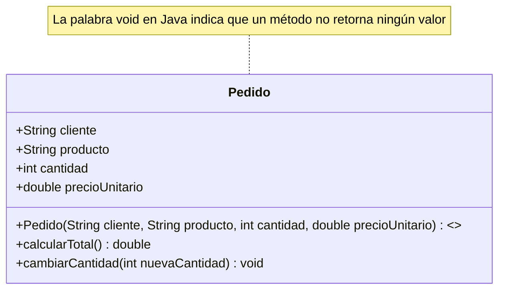

> **En una frase:** una clase describe las características y las acciones que tiene cierto elemento del dominio; un objeto es una instancia concreta creada a partir de esa descripción.

## ¿Qué aprenderás?

Al finalizar esta lección podrás:

- Explicar la diferencia entre una clase y un objeto.
- Reconocer atributos, métodos y constructores en una clase Java.
- Crear objetos y describir cómo sus atributos guardan estados independientes.

## 1. El problema que queremos resolver

Imagina una tienda que registra pedidos. De cada pedido necesita guardar quién lo hizo, qué producto pidió, cuántas unidades quiere, cuánto cuesta cada una y cuánto debe pagar en total.

Una primera solución puede guardar cada dato en una variable y calcular el total por separado:

```java
public class Main {
    public static void main(String[] args) {
        String cliente = "Ana";
        String producto = "Libro";
        int cantidad = 2;
        double precioUnitario = 12.50;
        double total = cantidad * precioUnitario;

        System.out.println(cliente + " pidió " + cantidad + " " + producto);
        System.out.println("Total: " + total);
    }
}
```

```text
Ana pidió 2 Libro
Total: 25.0
```

Esto sirve para un ejemplo pequeño. Pero, al añadir más pedidos, hay que crear y coordinar muchas más variables, y recordar qué datos pertenecen a un solo pedido. También vamos a terminar repitiendo el cálculo en distintos lugares.

Nos conviene representar cada pedido como una unidad: con sus propias características y los comportamientos que operan sobre ellos. Las clases y los objetos permiten modelar esa idea.

## 2. Explicación intuitiva


Piensa en la descripción de un pedido como un molde que indica qué información se guarda y qué operaciones se pueden hacer con ella. Esa descripción es la **clase**. Cada pedido que se crea a partir de ese molde es un **objeto**.

El molde puede indicar que todo pedido tiene un cliente, un producto, una cantidad de productos y un precio por unidad. Un pedido concreto (un objeto) puede ser el de Ana por dos libros; otro objeto distinto puede ser el de Luis por tres cuadernos. Ambos se crearon usando el mismo molde, pero los valores de sus datos (su estado) son diferentes e independientes.

> **Nota:** Cuando decimos que el estado de un objeto cambia, nos referimos a que sus datos se modifican (por ejemplo: si Ana pidió 2 libros y luego actualiza a 5 libros, el atributo de cantidad cambia y, por ende, cambia el estado del objeto).

## 3. Definición técnica

Una **clase** es una definición que agrupa atributos y métodos relacionados. Describe una clase de elementos que el programa puede representar; los nombres de las clases suelen escribirse por convención en PascalCase (UpperCamelCase).

```java
class CalculadoraInteligente {}
```

> **Nota:** Los atributos representan las características o datos y los métodos representan los comportamientos o acciones.

Un **objeto** es una instancia concreta de una clase. Tiene valores propios para sus atributos (también llamado estado interno) y puede realizar las acciones descritas por sus métodos.

### Partes principales

- **Atributos:** datos que describen el estado de un objeto. En Java se declaran como variables dentro de una clase; suelen escribirse por convención en camelCase.

```java
int cantidadDeEmpleados;
```

- **Métodos:** operaciones que representan el comportamiento de los objetos. Pueden consultar o modificar atributos y también pueden recibir información y devolver un resultado; también se escriben por convención en camelCase.

```java
int sumarDosNumerosEnteros(int a, int b);
```

- **Constructor:** operación especial que se ejecuta al crear un objeto. Tiene el mismo nombre que la clase y permite preparar sus atributos iniciales. No declara un tipo de retorno.

- **Objeto:** instancia creada a partir de una clase. Cada objeto mantiene sus propios valores para los atributos de instancia.

La forma en que se instancian los objetos es invocando los constructores de las clases.

En Java, una clase puede definir un constructor que recibe datos iniciales. Si se necesita construir objetos de distintas maneras, una clase puede tener varios constructores; en esta introducción usaremos uno para mantener el ejemplo sencillo.

### Conceptos con los que suele confundirse

**Clase y objeto:** la clase describe la estructura común; el objeto es un elemento concreto con valores propios. `Pedido` es una clase, mientras que el pedido de Ana es un objeto de esa clase.

**Atributo y variable local:** un atributo forma parte del estado de un objeto. Una variable local se declara dentro de un método y se utiliza durante esa operación; no es, por sí misma, uno de los datos que cada objeto conserva.

## 4. Representación visual de una Clase



## 5. Ejemplo inicial: datos y operación por separado

El primer ejemplo calcula el total con variables locales. Si después necesitamos actualizar la cantidad y volver a consultar el total, debemos asegurarnos de usar juntas las variables correctas y repetir o trasladar el cálculo.

El ejemplo no es incorrecto para una operación breve. La dificultad aparece cuando el programa debe conservar y manejar muchos pedidos relacionados.

## 6. Aplicación del concepto

Podemos describir un pedido con una clase. Sus atributos representan la información que conserva; sus métodos describen operaciones que utilizan esa información.

```java
class Pedido {
    String cliente;
    String producto;
    int cantidad;
    double precioUnitario;

    Pedido(String clienteDelPedido, String productoDelPedido,
           int cantidadInicial, double precioInicial) {
        cliente = clienteDelPedido;
        producto = productoDelPedido;
        cantidad = cantidadInicial;
        precioUnitario = precioInicial;
    }

    double calcularTotal() {
        return cantidad * precioUnitario;
    }

    void cambiarCantidad(int nuevaCantidad) {
        cantidad = nuevaCantidad;
    }
}

class EjemploPedidos {
    void ejecutar() {
        // Creamos los objetos usando el constructor de la clase Pedido (instancias concretas)
        Pedido pedidoAna = new Pedido("Ana", "Libro", 2, 12.50);
        Pedido pedidoLuis = new Pedido("Luis", "Cuaderno", 3, 10.00);

        System.out.println("Pedido de " + pedidoAna.cliente
            + ": " + pedidoAna.calcularTotal());
        System.out.println("Pedido de " + pedidoLuis.cliente
            + ": " + pedidoLuis.calcularTotal());

        pedidoAna.cambiarCantidad(3);
        System.out.println("Nuevo total del pedido de "
            + pedidoAna.cliente + ": " + pedidoAna.calcularTotal());
    }
}
```

### Explicación del código

- **`Pedido`:** es la clase que describe qué datos y operaciones tiene un pedido.
- **Atributos:** `cliente`, `producto`, `cantidad` y `precioUnitario` guardan el estado de cada pedido.
- **Constructor:** recibe los datos iniciales y los asigna a los atributos del nuevo objeto.
- **`calcularTotal`:** obtiene un resultado usando la cantidad y el precio del mismo pedido.
- **`cambiarCantidad`:** actualiza la cantidad del objeto sobre el que se invoca el método.
- **`pedidoAna` y `pedidoLuis`:** son dos objetos distintos, creados con la misma clase y con valores iniciales diferentes.

### Cómo probar el ejemplo

Con un kit de desarrollo de Java que incluya JShell, abre una consola con `jshell`, pega las definiciones de `Pedido` y `EjemploPedidos` y ejecuta esta expresión:

```java
new EjemploPedidos().ejecutar();
```

**Resultado esperado:**

```text
Pedido de Ana: 25.0
Pedido de Luis: 30.0
Nuevo total del pedido de Ana: 37.5
```

El código es ilustrativo y no se ha compilado durante la elaboración de esta lección. Para probarlo, también puedes integrar las clases en un proyecto Java existente y llamarlas desde el punto de entrada de tu aplicación.

### ¿Por qué funciona esta solución?

El constructor deja cada objeto preparado con sus datos iniciales. Después, los métodos consultan o actualizan los atributos de ese objeto. Así, la operación para calcular el total no necesita recibir por separado la cantidad y el precio: los encuentra en el pedido al que pertenece.

La misma clase permite crear muchos objetos sin volver a definir sus atributos y operaciones. Cada objeto conserva su propio estado.

## 7. Comparación entre enfoques

| Aspecto | Datos por separado | Clase y objetos |
|---|---|---|
| Relación entre los datos | Se coordinan mediante variables independientes. | Los datos de cada pedido se agrupan en una instancia. |
| Cálculo del total | La operación debe recibir o localizar los valores adecuados. | El método utiliza los atributos del pedido correspondiente. |
| Varios pedidos | Se necesitan más variables y coordinación. | Se crean más objetos de la misma clase. |
| Complejidad | Puede ser suficiente para una operación pequeña. | Añade una clase y resulta útil cuando se representan elementos con estado y comportamiento relacionados. |

Una clase no mejora automáticamente cualquier programa. Para un dato simple que no necesita comportamiento propio, una estructura de objetos podría añadir más conceptos que valor.

## 8. ¿Cuándo utilizar este concepto?

### Puede ser útil cuando

- El programa representa elementos con varios datos que deben mantenerse relacionados.
- Esos elementos tienen un estado que cambia durante el flujo del programa.
- Hay operaciones que utilizan repetidamente los mismos datos.
- Se necesitan varias instancias con una estructura común y valores independientes.

### Conviene tener cuidado cuando

- Se crea una clase para un valor simple sin comportamiento ni relaciones que modelar.
- La clase acumula responsabilidades que no representan un concepto claro.
- Se añaden atributos y métodos que el problema todavía no necesita.

## 9. Errores frecuentes

### Confundir la clase con un objeto

**Qué sucede:** se habla de la definición como si fuera un pedido concreto.

**Cómo evitarlo:** pregunta si te refieres al modelo común (`Pedido`) o a una instancia particular (`pedidoAna`).

### Pensar que todos los objetos tienen los mismos valores

**Qué sucede:** se asume que crear otra instancia copia el estado de la anterior.

**Cómo evitarlo:** recuerda que la clase define los atributos, pero cada objeto conserva sus propios valores.

### Tratar el constructor como un método ordinario

**Qué sucede:** se busca un tipo de retorno o se espera invocarlo como una operación posterior.

**Cómo evitarlo:** identifica el constructor por su nombre, que coincide con el de la clase. Se ejecuta al crear el objeto y prepara sus valores iniciales.

### Declarar datos relacionados como variables locales

**Qué sucede:** una operación necesita coordinar datos que pertenecen al mismo elemento y el programa los mantiene dispersos.

**Cómo evitarlo:** cuando esos datos describen un concepto del dominio y se usan juntos, evalúa representarlos como atributos de una clase.

## 10. Ejercicio práctico

### Enunciado

Modela un libro de una biblioteca. Cada libro debe guardar su título, autor y número de páginas. Crea un método que muestre una ficha con esos datos.

**Requisitos:**

1. Define una clase `Libro` con un atributo por cada dato.
2. Inicializa sus atributos mediante un constructor.
3. Crea dos libros con datos diferentes y muestra la ficha de cada uno.

### Pistas

- El constructor debe recibir los datos que necesita cada libro.
- El método que muestra la ficha puede leer los atributos del objeto.

### Solución propuesta

```java
class Libro {
    String titulo;
    String autor;
    int numeroDePaginas;

    Libro(String tituloInicial, String autorInicial, int paginasIniciales) {
        titulo = tituloInicial;
        autor = autorInicial;
        numeroDePaginas = paginasIniciales;
    }

    void mostrarFicha() {
        System.out.println(titulo + " — " + autor
            + " (" + numeroDePaginas + " páginas)");
    }
}

class EjemploLibros {
    void ejecutar() {
        Libro libroUno = new Libro("El camino", "Autora A", 180);
        Libro libroDos = new Libro("La ciudad", "Autor B", 240);

        libroUno.mostrarFicha();
        libroDos.mostrarFicha();
    }
}
```

**Explicación:** cada llamada al constructor crea un objeto `Libro` con valores propios. `mostrarFicha` consulta los atributos del objeto que recibe la llamada, por eso cada libro presenta sus propios datos.

La solución ilustra la estructura de clases y objetos; los títulos y nombres son datos de ejemplo, no referencias a obras concretas.

## 11. Resumen de la lección

- **Concepto principal:** una clase describe atributos y métodos; un objeto es una instancia concreta de esa clase.
- **Problema que resuelve:** permite agrupar datos relacionados y las operaciones que trabajan con ellos.
- **Cuándo aplicarlo:** cuando el programa necesita representar elementos con estado y comportamiento comunes.
- **Principal precaución:** no crear clases innecesarias ni asumir que instancias distintas comparten los mismos valores.

## 12. Comprueba tu comprensión

1. ¿Qué diferencia hay entre la clase `Pedido` y el objeto `pedidoAna`?
2. Si cambias la cantidad de `pedidoAna`, ¿por qué no cambia la de `pedidoLuis`?
3. Si necesitas calcular el total de un pedido desde varios lugares, ¿qué ventaja tiene definir esa operación en la clase?

## 13. Continúa aprendiendo

Puedes volver a la ruta de [Fundamentos de POO](/categorias/fundamentos-poo/) para explorar las próximas lecciones cuando estén publicadas.
