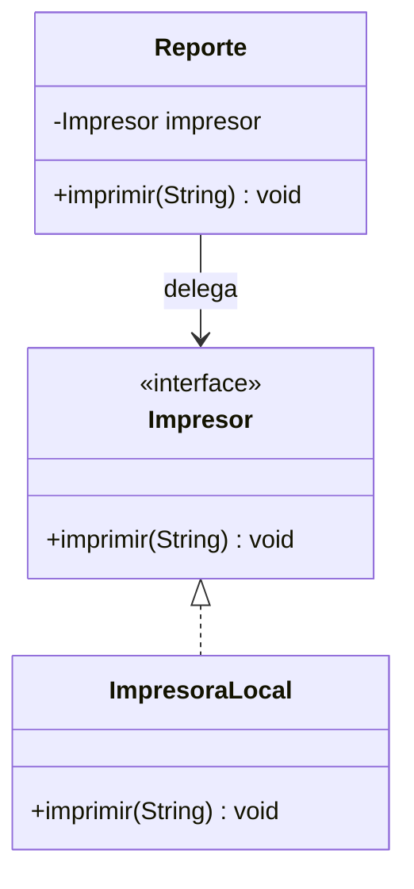

# Composición y diseño orientado a objetos

> **En una frase:** la composición construye un objeto con colaboradores y permite delegarles trabajo, reduciendo jerarquías y limitando dependencias innecesarias.

## ¿Qué aprenderás?

- Aplicar la relación tiene-un en lugar de una herencia incorrecta.
- Delegar operaciones a objetos colaboradores.
- Reconocer cohesión y acoplamiento como señales para revisar un diseño.

## 1. El problema que queremos resolver

Supón que una clase `Reporte` extiende `Impresora` únicamente para reutilizar su método `imprimir`. Esa relación dice que todo reporte es una impresora y hereda también su contrato y futuras decisiones. En realidad, un reporte **puede usar** un dispositivo de impresión; el comportamiento puede delegarse a un colaborador.

## 2. Definición técnica

La **composición** conecta un objeto con objetos que colaboran con él: una relación «tiene-un». El objeto compuesto ofrece operaciones del dominio y **delega** parte de su trabajo a los componentes. No es lo mismo que «crear muchos objetos» ni obliga a que cada componente tenga el mismo ciclo de vida que el objeto que lo utiliza.

**Cohesión** describe cuánto se relacionan las responsabilidades de una clase con un propósito claro; más cohesión suele facilitar su comprensión. **Acoplamiento** describe cuánto depende una pieza de detalles de otras; dependencias concretas y extensas dificultan cambios independientes. Son criterios de diseño, no números absolutos ni garantías automáticas.

Favorecer composición sobre herencia es una heurística: hereda cuando existe una relación es-un que respeta el contrato; compón cuando un objeto usa o combina capacidades. Refactorizar una jerarquía puede implicar extraer una interfaz o colaborador y delegar en él, siempre comprobando que el comportamiento observable se conserve.

## 3. Diagrama



`Reporte` conoce el contrato de impresión y delega la operación al colaborador, no hereda su identidad.

## 4. Ejemplo en Java

```java
interface Impresor {
    void imprimir(String contenido);
}

class ImpresoraLocal implements Impresor {
    @Override
    public void imprimir(String contenido) {
        System.out.println("Imprimiendo: " + contenido);
    }
}

class Reporte {
    private final Impresor impresor;

    Reporte(Impresor impresor) {
        if (impresor == null) {
            throw new IllegalArgumentException("Se requiere un impresor");
        }
        this.impresor = impresor;
    }

    public void imprimir(String contenido) {
        impresor.imprimir(contenido);
    }
}

class Main {
    public static void main(String[] args) {
        Reporte reporte = new Reporte(new ImpresoraLocal());
        reporte.imprimir("Ventas del mes");
    }
}
```

`Reporte` conserva un colaborador tipado por interfaz y delega la acción. Puede añadirse otra implementación de `Impresor` sin convertir `Reporte` en una subclase de esa implementación. Resultado esperado: `Imprimiendo: Ventas del mes`.

Guarda como `Main.java`, compila con `javac Main.java` y ejecuta con `java Main`.

## 5. Cuándo elegir composición

Úsala cuando el objeto necesite combinar comportamientos, cambiar el colaborador o depender de una capacidad sin ser una especialización de ese tipo. Si los colaboradores son estables, pequeños y exclusivos del objeto, mantenerlos puede ser apropiado; no añadas interfaces y capas sin una necesidad concreta.

### Señales para revisar una clase

- Tiene responsabilidades que cambian por razones distintas: puede faltarle cohesión.
- Depende de muchas implementaciones concretas: puede existir acoplamiento innecesario.
- Una subclase hereda operaciones que no tienen sentido para ella: revisa si la jerarquía expresa una relación es-un válida.

## 6. Errores frecuentes

- **Componer por moda:** cada intermediario agrega conceptos y navegación; usa composición para resolver una necesidad real.
- **Conservar una superclase por código compartido:** compartir implementación no es suficiente para establecer «es-un».
- **Confundir independencia absoluta con bajo acoplamiento:** los objetos colaboran; el objetivo es que las dependencias sean explícitas y razonables.

## 7. Ejercicio práctico

### Enunciado

Un `Reproductor` reproduce audio y puede utilizar diferentes salidas (`Altavoz` o `Auriculares`). Diseña una solución con un colaborador y explica por qué no harías que `Reproductor` heredara de `Altavoz`.

<details>
<summary>Mostrar pista</summary>

Define una interfaz `SalidaAudio` con `reproducir(String)` y guarda una referencia a ella en `Reproductor`. Delegar permite seleccionar o sustituir la salida sin decir que un reproductor es un altavoz.
</details>

## 8. Resumen y comprensión

- La composición representa colaboración tiene-un; la herencia expresa especialización es-un.
- Delegar concentra cada responsabilidad donde corresponde.
- Cohesión y acoplamiento ayudan a evaluar el coste de comprensión y cambio, pero no son reglas mecánicas.

1. ¿Qué relación conceptual expresa `Reporte` con `Impresor`?
2. ¿Por qué reutilizar código no basta para justificar `extends`?
3. ¿Qué posible dificultad revela una clase con responsabilidades no relacionadas?

## 9. Continúa aprendiendo

- **Requisito previo:** [Herencia](/lecciones/herencia/), [Relaciones entre clases](/lecciones/relaciones-entre-clases/).
- **Siguiente lección:** [Modelado con UML](/lecciones/modelado-con-uml/).
- **Tema relacionado:** [Interfaces y contratos](/lecciones/interfaces-y-contratos/).

## 10. Fuente

- Bloch, Joshua. *Effective Java*, 3.ª ed., elemento 18: «Favor composition over inheritance». Addison-Wesley, 2018.
