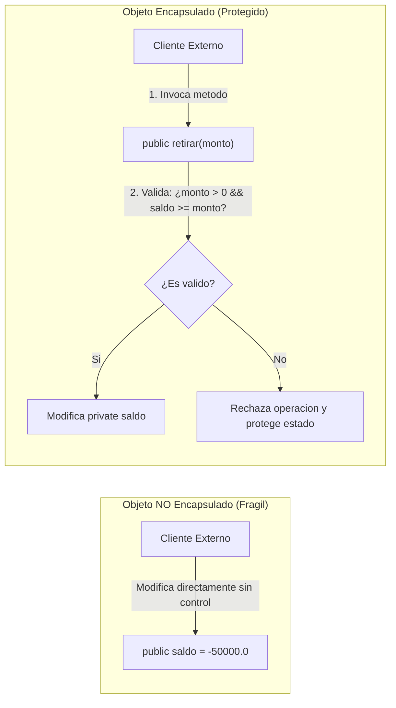

# Encapsulamiento

> **En una frase:** el encapsulamiento es el escudo que protege el estado interno de un objeto, restringiendo el acceso directo a sus variables y forzando que cualquier interacción ocurra mediante métodos controlados que preserven sus reglas de integridad.

En la lección anterior ([Atributos, métodos y constructores](/lecciones/atributos-metodos-y-constructores/)) aprendimos a dotar a nuestras clases de constructores para inicializar sus datos y métodos para modelar sus acciones. Sin embargo, si permitimos que cualquier parte del programa acceda y altere directamente esos atributos, cualquier garantía de corrección se desvanece. En esta lección aprenderemos a blindar nuestros objetos mediante modificadores de acceso y defensa de **invariantes**.

## ¿Qué aprenderás?

Al finalizar esta lección podrás:

- Explicar por qué exponer atributos directamente fragiliza el software y dificulta su mantenimiento.
- Dominar los 4 niveles de acceso de Java (`private`, acceso de paquete por defecto, `protected` y `public`).
- Diseñar métodos de acceso (*getters*) y modificación (*setters*) que validen reglas de negocio y protejan la coherencia del objeto.
- Reconocer qué es una **invariante de clase** y cómo mantenerla intacta desde la creación del objeto.
- Evitar el error de generar *getters* y *setters* mecánicamente sin considerar el diseño del dominio.

---

## 1. El problema que queremos resolver

Imagina que estás construyendo una plataforma de billetera digital para pagos móviles. En un diseño inicial descuidado, decides declarar el saldo del usuario como un atributo accesible para todos:

```java
public class BilleteraDigital {
    public String titular;
    public double saldo; // ¡Peligro: acceso público irrestricto!
}
```

En este escenario, cualquier desarrollador del equipo (o cualquier línea de código del sistema) puede hacer lo siguiente desde cualquier lugar:

```java
BilleteraDigital billetera = new BilleteraDigital();
billetera.saldo = -50000.0; // ¡Saldo negativo sin pasar por ninguna verificación!
```

¿Qué graves consecuencias genera esta decisión?

1. **Corrupción del estado sin trazabilidad:** el saldo ahora es negativo, violando la regla legal del banco. ¿Qué función provocó el error? ¿Cuándo ocurrió? Es imposible saberlo porque 50 clases distintas tenían permiso para reescribir la variable `saldo`.
2. **Imposibilidad de auditar y registrar eventos:** cuando un usuario gasta dinero, el banco debe registrar la fecha, emitir un comprobante y enviar una notificación. Si la variable se altera directamente, ninguna de esas acciones complementarias se dispara.
3. **Rigidez extrema ante cambios técnicos:** supón que más adelante decides cambiar el tipo de dato de `saldo` a `long` (para almacenar centavos exactos y evitar errores de precisión de coma flotante). Como cientos de archivos externos accedían directamente a `billetera.saldo` esperando un `double`, **todo el sistema dejará de compilar**.

El **encapsulamiento** y el **ocultamiento de información** (*information hiding*) existen precisamente para erradicar estos tres problemas.

---

## 2. Explicación intuitiva

Para visualizar el encapsulamiento, piensa en un **cajero automático (ATM)** o en una **máquina expendedora**:


- **El interior de la máquina está blindado:** el dinero en efectivo, los rodillos contadores y los sensores de billetes falsos están bajo llave dentro de una caja de acero. Nadie en la calle puede meter la mano para ajustar la cantidad de billetes que hay en los compartimentos.
- **La máquina te expone una interfaz pública y segura:** una pantalla, un teclado numérico y una ranura de retiro.
- **La transacción pasa por validaciones rigurosas:** cuando solicitas retirar $100, la máquina no te da el dinero a ciegas. Primero verifica tu PIN, comprueba si tienes fondos suficientes en tu cuenta, descuenta la cantidad internamente y, solo si todo es correcto, expulsa los billetes.

Un objeto encapsulado funciona exactamente igual: sus datos sensibles están bajo llave (`private`) en el interior de su estructura. El mundo exterior solo puede interactuar con él mediante las "ranuras y botones" autorizados (métodos `public`), los cuales inspeccionan y validan cada operación antes de alterar el estado.

---

## 3. Definición técnica

El **encapsulamiento** es el principio del diseño orientado a objetos que agrupa los datos (atributos) y el código que opera sobre ellos (métodos) en una misma unidad, restringiendo el acceso directo a los componentes internos del objeto para evitar interferencias externas o usos indebidos.

### 3.1. Los 4 niveles de acceso en Java

Java ofrece cuatro modificadores de acceso para controlar la visibilidad de clases, atributos, métodos y constructores:

| Modificador | En la misma clase | En el mismo paquete (*package*) | En subclases (otro paquete) | En cualquier otra parte del programa |
| :--- | :---: | :---: | :---: | :---: |
| **`private`** |  Sí | ❌ No | ❌ No | ❌ No |
| *(Predeterminado / package-private)* |  Sí |  Sí | ❌ No | ❌ No |
| **`protected`** |  Sí |  Sí |  Sí | ❌ No |
| **`public`** |  Sí |  Sí |  Sí |  Sí |

**Regla de oro de la ingeniería de software:** aplica siempre el **principio de menor privilegio**. Comienza declarando todos los atributos como `private`. Solo incrementa la visibilidad si existe una justificación técnica o de diseño clara e ineludible.

### 3.2. Invariantes de clase

Una **invariante de clase** es una condición o regla lógica sobre el estado del objeto que **siempre debe ser verdadera** durante toda su existencia (después del constructor y antes/después de la ejecución de cualquier método público).

**Ejemplos de invariantes:**
- *"El saldo de una cuenta corriente nunca puede ser inferior a $0.0"*.
- *"El porcentaje de descuento debe encontrarse estrictamente entre 0.0 y 1.0"*.
- *"El nombre de un cliente no puede ser nulo (`null`) ni estar en blanco"*.

El encapsulamiento es el mecanismo técnico que garantiza que las invariantes no puedan ser vulneradas desde el exterior.

### 3.3. Métodos accesores (*getters*) y mutadores (*setters*)

- **Getter (Accesor):** método público que devuelve el valor de un atributo privado sin permitir su alteración directa (`public double getSaldo()`).
- **Setter (Mutador):** método público que recibe un nuevo valor, evalúa que satisfaga las invariantes de la clase y, si es válido, lo asigna al atributo privado (`public void setNombre(String nombre)`).

> **Aviso de diseño:** no todos los atributos privados necesitan un *setter*. Si un dato no debe modificarse una vez creado el objeto (como el número de documento de identidad de una persona o el código de cuenta bancaria), simplemente **no escribas el método setter**. De este modo el atributo se vuelve de solo lectura hacia el exterior.

### 3.4. Fuga de encapsulamiento (*Representation Exposure*)

Ocurre cuando un método devuelve directamente una referencia a un objeto mutable interno (como una fecha `java.util.Date`, un arreglo o una lista). Aunque el atributo esté declarado como `private`, quien reciba la referencia puede modificar el contenido interno del objeto sin que la clase anfitriona se entere.

Para evitarlo, se aplican **copias defensivas** (*defensive copying*) al recibir y devolver objetos mutables.

---

## 4. Representación visual

Compara la fragilidad de un objeto desprotegido frente a la robustez de un objeto encapsulado:



**Cómo interpretar el diagrama:**
- En el diseño sin encapsular, el cliente externo tiene acceso libre a la variable interna, destruyendo cualquier regla de negocio.
- En el diseño encapsulado, el cliente se comunica exclusivamente con el método público, el cual actúa como guardián de la integridad de los datos.

---

## 5. Ejemplo inicial: el desastre de los datos públicos

Observa qué ocurre en un sistema de reservas hoteleras cuando los atributos de una habitación son públicos:

```java
// Mal diseño: atributos públicos sin protección
class HabitacionHotelDefectuosa {
    public int numeroHabitacion;
    public int capacidadPersonas;
    public double precioPorNoche;
    public boolean ocupada;
}

public class SistemaHotelProblematico {
    public static void main(String[] args) {
        HabitacionHotelDefectuosa hab = new HabitacionHotelDefectuosa();
        hab.numeroHabitacion = 101;
        hab.capacidadPersonas = 2;
        hab.precioPorNoche = 80.0;

        // Cualquier parte del programa puede corromper el estado:
        hab.capacidadPersonas = -5;  // ¿Una habitación para menos cinco personas?
        hab.precioPorNoche = -100.0; // ¿El hotel le paga al huésped por quedarse?
        hab.ocupada = false;         // Se desocupa sin cobrar ni limpiar

        System.out.println("Habitación: " + hab.numeroHabitacion);
        System.out.println("Capacidad: " + hab.capacidadPersonas);
        System.out.println("Precio: $" + hab.precioPorNoche);
    }
}
```

### ¿Qué problemas observamos?

1. **Valores físicamente absurdos:** el sistema acepta una capacidad de `-5` personas y un precio de `$-100.0` sin quejarle, corrompiendo la base de datos de facturación.
2. **Sin validación centralizada:** para impedir precios negativos, tendríamos que acordarnos de poner un `if (precio > 0)` en cada pantalla, formulario o endpoint donde alguien toque la variable.
3. **Ausencia total de control:** el objeto es una estructura pasiva de datos en lugar de una entidad inteligente que cuida de sí misma.

---

## 6. Aplicación del concepto

Blindemos la clase aplicando encapsulamiento estricto, atributos privados, constructores con validación y métodos con lógica de negocio clara:

```java
class HabitacionHotel {

    // 1. Atributos privados: inaccesibles desde el exterior
    private final int numeroHabitacion; // Inmutable: el número no cambia tras construirse
    private int capacidadPersonas;
    private double precioPorNoche;
    private boolean ocupada;

    // 2. Constructor: valida las invariantes desde el instante cero
    public HabitacionHotel(int numeroHabitacion, int capacidadPersonas, double precioPorNoche) {
        if (numeroHabitacion <= 0) {
            throw new IllegalArgumentException("El número de habitación debe ser positivo.");
        }
        this.numeroHabitacion = numeroHabitacion;

        // Reutilizamos los mutadores con validación
        setCapacidadPersonas(capacidadPersonas);
        setPrecioPorNoche(precioPorNoche);
        this.ocupada = false; // Nace libre por defecto
    }

    // 3. Getters (Lectura segura)
    public int getNumeroHabitacion() {
        return this.numeroHabitacion;
    }

    public int getCapacidadPersonas() {
        return this.capacidadPersonas;
    }

    public double getPrecioPorNoche() {
        return this.precioPorNoche;
    }

    public boolean isOcupada() {
        return this.ocupada;
    }

    // 4. Setters con validación rigurosa de invariantes
    public void setCapacidadPersonas(int capacidadPersonas) {
        if (capacidadPersonas <= 0 || capacidadPersonas > 8) {
            System.out.println("Error: la capacidad debe ser entre 1 y 8 huéspedes. Se conserva valor previo.");
            return;
        }
        this.capacidadPersonas = capacidadPersonas;
    }

    public void setPrecioPorNoche(double precioPorNoche) {
        if (precioPorNoche <= 0.0) {
            System.out.println("Error: el precio por noche debe ser estrictamente positivo.");
            return;
        }
        this.precioPorNoche = precioPorNoche;
    }

    // 5. Métodos de comportamiento de dominio (en lugar de alterar 'ocupada' directamente)
    public boolean registrarHuespedes(int cantidadHuespedes) {
        if (this.ocupada) {
            System.out.println("Operación fallida: la habitación " + this.numeroHabitacion + " ya se encuentra ocupada.");
            return false;
        }
        if (cantidadHuespedes <= 0 || cantidadHuespedes > this.capacidadPersonas) {
            System.out.println("Operación fallida: cantidad de huéspedes excede la capacidad máxima (" + this.capacidadPersonas + ").");
            return false;
        }
        this.ocupada = true;
        System.out.println("Check-in exitoso en habitación " + this.numeroHabitacion + " para " + cantidadHuespedes + " personas.");
        return true;
    }

    public void liberarHabitacion() {
        if (!this.ocupada) {
            System.out.println("Aviso: la habitación " + this.numeroHabitacion + " ya estaba disponible.");
            return;
        }
        this.ocupada = false;
        System.out.println("Habitación " + this.numeroHabitacion + " liberada con éxito. Lista para limpieza.");
    }
}

public class GestionHotelera {

    public static void main(String[] args) {
        HabitacionHotel suite = new HabitacionHotel(201, 4, 150.0);

        System.out.println("Habitación creada: #" + suite.getNumeroHabitacion() 
            + " | Precio: $" + suite.getPrecioPorNoche());

        // Intentos de alterar el estado con datos corruptos:
        System.out.println("\n--- Intentos no válidos ---");
        suite.setPrecioPorNoche(-50.0);  // Rechazado por validación
        suite.setCapacidadPersonas(20);  // Rechazado por validación

        // Operaciones de negocio controladas:
        System.out.println("\n--- Operaciones de negocio ---");
        suite.registrarHuespedes(5);     // Falla: excede capacidad máxima de 4
        suite.registrarHuespedes(3);     // Éxito: 3 cabe en capacidad 4
        suite.registrarHuespedes(1);     // Falla: ya está ocupada

        suite.liberarHabitacion();       // Éxito: queda disponible nuevamente

        System.out.println("\nEstado final: ¿Ocupada? " + suite.isOcupada());
    }
}
```

### Explicación del código

- **`private final int numeroHabitacion`:** al ser `final` y no tener setter, es un valor inmutable. Nadie puede cambiar el número físico de la habitación una vez registrada.
- **`isOcupada()`:** por convención en Java, los métodos *getters* para tipos booleanos utilizan el prefijo `is` en lugar de `get`.
- **`registrarHuespedes(...)` y `liberarHabitacion()`:** en lugar de exponer un simple `setOcupada(boolean)`, modelamos las acciones reales del dominio. La propia habitación valida si ya estaba ocupada o si los huéspedes exceden la capacidad permitida.
- **Protección de invariantes:** es imposible dejar la habitación con precio negativo o capacidad cero, porque tanto el constructor como los métodos mutadores rechazan esos valores.

### Cómo ejecutar el ejemplo

1. Guarda el código en un archivo llamado `GestionHotelera.java`.
2. Compila en tu terminal con:
   ```bash
   javac GestionHotelera.java
   ```
3. Ejecuta con:
   ```bash
   java GestionHotelera
   ```

**Resultado esperado:**

```text
Habitación creada: #201 | Precio: $150.0

--- Intentos no válidos ---
Error: el precio por noche debe ser estrictamente positivo.
Error: la capacidad debe ser entre 1 y 8 huéspedes. Se conserva valor previo.

--- Operaciones de negocio ---
Operación fallida: cantidad de huéspedes excede la capacidad máxima (4).
Check-in exitoso en habitación 201 para 3 personas.
Operación fallida: la habitación 201 ya se encuentra ocupada.
Habitación 201 liberada con éxito. Lista para limpieza.

Estado final: ¿Ocupada? false
```

---

## 7. Comparación entre enfoques

| Criterio | Atributos públicos (Sin encapsular) | Atributos privados con métodos controlados |
| :--- | :--- | :--- |
| **Integridad del estado** | Nula: cualquier valor (incluso incoherente o corrupto) puede asignarse. | Total: el objeto solo admite estados que cumplan sus invariantes. |
| **Facilidad de evolución** | Muy baja: cambiar un tipo de dato o lógica rompe el código de todos los clientes. | Muy alta: la representación interna puede cambiar libremente sin alterar la interfaz pública. |
| **Trazabilidad y depuración** | Difícil: no sabes qué línea de código modificó una variable. | Sencilla: puedes colocar un punto de interrupción (*breakpoint*) en el método mutador. |
| **Control de permisos** | Todo o nada: cualquiera puede leer y escribir. | Granular: puedes tener atributos de solo lectura, de solo escritura o restringidos. |

---

## 8. ¿Cuándo utilizar este concepto?

### Casos en los que resulta obligatorio

- **Siempre en clases del modelo de dominio:** cuentas bancarias, usuarios, pedidos, inventario, transacciones. Prácticamente el 99% de las clases en un sistema profesional deben encapsular su estado.
- **Cuando existan invariantes o reglas de validación:** cualquier campo que dependa de límites matemáticos, formatos o restricciones comerciales.
- **Al diseñar librerías o APIs:** para proteger a los usuarios de la librería de cambios internos futuros.

### Cuándo no utilizarlo o tener precaución

- **Estructuras de datos puras de transporte (DTOs / Records):** en Java moderno, cuando una clase sirve exclusivamente para transportar datos entre capas sin comportamiento propio, es preferible utilizar un `record` de Java (introducido en Java 16), el cual genera automáticamente inmutabilidad, getters y constructores canónicos.
- **El antipatrón del "Getter/Setter ciego":** no crees automáticamente un getter y un setter para cada campo privado con tu IDE si no los necesitas. Una clase que expone getters y setters para absolutamente todo es casi tan frágil como una clase con atributos públicos. Pregúntate siempre: *«¿este atributo realmente necesita poder modificarse libremente desde afuera?»*.

---

## 9. Errores frecuentes

### Error 1: Exponer referencias a objetos mutables internos (*Representation Exposure*)

**Qué sucede:**
```java
class RegistroVisitas {
    private List<String> visitantes = new ArrayList<>();

    // Fuga de encapsulamiento:
    public List<String> getVisitantes() {
        return this.visitantes; // Devuelve la referencia directa a la lista interna
    }
}
```
**Por qué ocurre:** aunque la lista `visitantes` es `private`, quien llama a `getVisitantes().clear()` borra todos los datos internos de la clase sin que esta pueda impedirlo.  
**Cómo evitarlo:** devuelve una copia inmodificable o una copia nueva:
```java
public List<String> getVisitantes() {
    return Collections.unmodifiableList(this.visitantes);
}
```

---

### Error 2: Validar únicamente en el *setter* pero olvidar validar en el constructor

**Qué sucede:** el programador programa una validación meticulosa en `setEdad(int edad)`, pero en el constructor escribe:
```java
public Persona(String nombre, int edad) {
    this.nombre = nombre;
    this.edad = edad; // ¡Asignación directa sin validar! Si pasan -10, el objeto nace corrupto
}
```
**Cómo evitarlo:** en el constructor, valida directamente los argumentos o invoca el propio método mutador: `setEdad(edad);`.

---

## 10. Ejercicio práctico

### Enunciado

Diseña una clase llamada `TermostatoInteligente` que controle la temperatura deseada de una habitación, asegurando que el estado nunca viole las leyes térmicas ni la seguridad del hogar.

**Requisitos:**

1. **Atributos privados:**
   - `identificador` (`String`): inmutable tras crearse (solo lectura).
   - `temperaturaObjetivo` (`double`): temperatura en grados Celsius que el termostato busca alcanzar.
   - `modoAhorroEnergia` (`boolean`): indica si el ahorro está activo.
2. **Invariantes:**
   - La `temperaturaObjetivo` nunca puede ser inferior a `10.0 °C` (límite anti-congelamiento) ni superior a `32.0 °C` (límite de confort y seguridad).
   - Si el `modoAhorroEnergia` está activo, la temperatura máxima permitida se reduce automáticamente a `21.0 °C`.
3. **Constructores:**
   - Un constructor que reciba `identificador` y `temperaturaObjetivoInicial`. Debe validar que el identificador no sea nulo ni vacío, y que la temperatura respete el rango `[10.0, 32.0]`. Por defecto, el modo ahorro inicia en `false`.
4. **Métodos:**
   - `getIdentificador()`, `getTemperaturaObjetivo()`, `isModoAhorroEnergia()`.
   - `ajustarTemperatura(double nuevaTemperatura)`: actualiza la temperatura si respeta el límite correspondiente (según esté activo o no el modo ahorro). Si está fuera de rango, rechaza el cambio con un mensaje explicativo y mantiene el valor anterior.
   - `activarModoAhorro()`: activa el modo ahorro. Si la temperatura actual sobrepasa los `21.0 °C`, la ajusta automáticamente a `21.0 °C` para cumplir la regla de ahorro.
   - `desactivarModoAhorro()`: desactiva el modo ahorro, restaurando el límite superior a `32.0 °C`.

---

### Pistas

<details>
<summary>Mostrar pistas</summary>

- Declara constantes privadas para los límites: `LIMITE_MINIMO = 10.0`, `LIMITE_MAXIMO = 32.0` y `LIMITE_MAXIMO_AHORRO = 21.0`.
- En `ajustarTemperatura`, determina el tope máximo actual: `double topeMaximo = modoAhorroEnergia ? LIMITE_MAXIMO_AHORRO : LIMITE_MAXIMO;`.
- En `activarModoAhorro()`, recuerda verificar: `if (this.temperaturaObjetivo > LIMITE_MAXIMO_AHORRO) { this.temperaturaObjetivo = LIMITE_MAXIMO_AHORRO; }`.

</details>

---

### Solución propuesta

<details>
<summary>Mostrar solución y explicación</summary>

```java
class TermostatoInteligente {

    private static final double MIN_TEMP = 10.0;
    private static final double MAX_TEMP_ESTANDAR = 32.0;
    private static final double MAX_TEMP_AHORRO = 21.0;

    private final String identificador;
    private double temperaturaObjetivo;
    private boolean modoAhorroEnergia;

    public TermostatoInteligente(String identificador, double temperaturaInicial) {
        if (identificador == null || identificador.trim().isEmpty()) {
            throw new IllegalArgumentException("El identificador del termostato no puede ser nulo ni vacío.");
        }
        this.identificador = identificador;
        this.modoAhorroEnergia = false;

        if (temperaturaInicial < MIN_TEMP || temperaturaInicial > MAX_TEMP_ESTANDAR) {
            System.out.println("Temperatura inicial fuera de rango seguro. Se establece valor por defecto (20.0 °C).");
            this.temperaturaObjetivo = 20.0;
        } else {
            this.temperaturaObjetivo = temperaturaInicial;
        }
    }

    public String getIdentificador() {
        return this.identificador;
    }

    public double getTemperaturaObjetivo() {
        return this.temperaturaObjetivo;
    }

    public boolean isModoAhorroEnergia() {
        return this.modoAhorroEnergia;
    }

    public boolean ajustarTemperatura(double nuevaTemperatura) {
        double maximoPermitido = this.modoAhorroEnergia ? MAX_TEMP_AHORRO : MAX_TEMP_ESTANDAR;

        if (nuevaTemperatura < MIN_TEMP || nuevaTemperatura > maximoPermitido) {
            System.out.println("Ajuste denegado: " + nuevaTemperatura + " °C no está dentro del rango permitido [" 
                + MIN_TEMP + " °C - " + maximoPermitido + " °C].");
            return false;
        }

        this.temperaturaObjetivo = nuevaTemperatura;
        System.out.println("Temperatura de [" + this.identificador + "] fijada en " + this.temperaturaObjetivo + " °C.");
        return true;
    }

    public void activarModoAhorro() {
        this.modoAhorroEnergia = true;
        System.out.println("Modo ahorro activado en [" + this.identificador + "]. Tope máximo reducido a " + MAX_TEMP_AHORRO + " °C.");
        if (this.temperaturaObjetivo > MAX_TEMP_AHORRO) {
            this.temperaturaObjetivo = MAX_TEMP_AHORRO;
            System.out.println("Aviso: temperatura reajustada automáticamente a " + MAX_TEMP_AHORRO + " °C para optimizar consumo.");
        }
    }

    public void desactivarModoAhorro() {
        this.modoAhorroEnergia = false;
        System.out.println("Modo ahorro desactivado en [" + this.identificador + "]. Tope restaurado a " + MAX_TEMP_ESTANDAR + " °C.");
    }
}

public class PruebaTermostato {

    public static void main(String[] args) {
        TermostatoInteligente sala = new TermostatoInteligente("TERM-SALA", 22.5);

        System.out.println("Termostato: " + sala.getIdentificador());
        System.out.println("Temperatura actual: " + sala.getTemperaturaObjetivo() + " °C");

        // Intentamos fijar temperatura excesiva
        sala.ajustarTemperatura(35.0); // Rechazado (> 32)

        // Activamos modo ahorro teniendo 22.5 °C
        sala.activarModoAhorro();
        System.out.println("Temperatura tras activar ahorro: " + sala.getTemperaturaObjetivo() + " °C");

        // Intentamos subir a 24 en modo ahorro
        sala.ajustarTemperatura(24.0); // Rechazado (> 21)

        // Desactivamos ahorro y volvemos a intentar
        sala.desactivarModoAhorro();
        sala.ajustarTemperatura(24.0); // Aprobado
    }
}
```

**Resultado esperado:**

```text
Termostato: TERM-SALA
Temperatura actual: 22.5 °C
Ajuste denegado: 35.0 °C no está dentro del rango permitido [10.0 °C - 32.0 °C].
Modo ahorro activado en [TERM-SALA]. Tope máximo reducido a 21.0 °C.
Aviso: temperatura reajustada automáticamente a 21.0 °C para optimizar consumo.
Temperatura tras activar ahorro: 21.0 °C
Ajuste denegado: 24.0 °C no está dentro del rango permitido [10.0 °C - 21.0 °C].
Modo ahorro desactivado en [TERM-SALA]. Tope restaurado a 32.0 °C.
Temperatura de [TERM-SALA] fijada en 24.0 °C.
```

**Explicación:**  
Los atributos son privados y el identificador es `final`. No hay ningún camino mediante el cual un usuario pueda colocar la temperatura en valores negativos o superiores a los límites legales del dispositivo. El método `activarModoAhorro` vela proactivamente por la invariante reduciendo la temperatura si esta superaba el nuevo techo.

</details>

---

## 11. Resumen de la lección

- **Definición central:** el encapsulamiento protege el estado interno de los objetos agrupando datos y operaciones, exponiendo interfaces públicas controladas.
- **Niveles de visibilidad:** `private` es la opción predeterminada para atributos. `public` se reserva para la interfaz y operaciones intencionales.
- **Invariantes:** reglas de coherencia del dominio que el objeto debe salvaguardar en todo momento mediante validación en constructores y mutadores.
- **Ventaja de mantenimiento:** al ocultar la representación interna, los cambios en los atributos no rompen las aplicaciones que consumen la clase.

---

## 12. Comprueba tu comprensión

1. ¿Por qué declarar todos los atributos como `public` destruye la modularidad y el principio de mantenimiento de un proyecto?
2. ¿Cuál es la diferencia de visibilidad entre un miembro sin modificador (*package-private*) y uno marcado como `protected` en Java?
3. Si una clase tiene 5 atributos privados y solo provee métodos *getters* (ningún *setter*), ¿qué propiedad adquieren sus instancias hacia el exterior?
4. ¿En qué consiste el error de "fuga de encapsulamiento" (*representation exposure*) al trabajar con colecciones o arreglos mutables dentro de una clase?

---

## 13. Continúa aprendiendo

- **Lección anterior:** [Atributos, métodos y constructores](/lecciones/atributos-metodos-y-constructores/)
- **Siguiente lección recomendada:** [Abstracción](/lecciones/abstraccion/) — donde aprenderás a separar los conceptos esenciales de un problema de los detalles concretos de implementación utilizando clases y métodos abstractos.
- **Ruta de aprendizaje:** [Fundamentos de POO](/categorias/fundamentos-poo/)

---

## 14. Fuentes y lecturas recomendadas

- Oracle. *The Java Tutorials: Controlling Access to Members of a Class*. [docs.oracle.com/javase/tutorial/java/javaOO/accesscontrol.html](https://docs.oracle.com/javase/tutorial/java/javaOO/accesscontrol.html)
- Joshua Bloch. *Effective Java* (3rd Edition). Addison-Wesley, 2018. Item 15: «Minimize the accessibility of classes and members» e Item 16: «In public classes, use accessor methods, not public fields».
- Cay S. Horstmann. *Core Java Volume I: Fundamentals* (12th Edition). Pearson, 2022. Capítulo 4: «Encapsulation».
