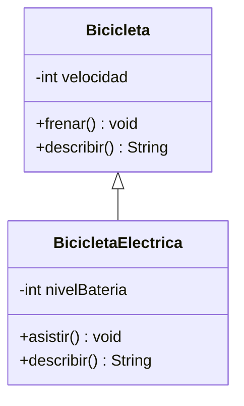

# Herencia

> **En una frase:** la herencia permite definir una clase especializada a partir de otra, reutilizando y refinando su comportamiento cuando la relación entre ambas realmente es «es un».

## ¿Qué aprenderás?

- Identificar superclases, subclases y relaciones es-un.
- Inicializar la parte heredada con `super` y sobrescribir métodos con `@Override`.
- Reconocer los costes de una jerarquía rígida antes de elegir herencia.

## 1. El problema que queremos resolver

En una aplicación de transporte, una bicicleta eléctrica y una bicicleta de paseo comparten datos y acciones: ambas tienen una velocidad y pueden frenar. Copiar la implementación común en dos clases duplica código; una modificación posterior puede dejar las clases inconsistentes. Una superclase puede reunir lo verdaderamente común, mientras las subclases añaden sus especializaciones.

## 2. Explicación intuitiva

Piensa en una categoría y sus variantes: una bicicleta eléctrica sigue siendo una bicicleta, pero además administra una batería. La especialización hereda lo que la categoría general promete y puede completar o redefinir ciertos comportamientos.

**Límite de la analogía:** una jerarquía de clases es una decisión del modelo de software, no una afirmación de que toda taxonomía del mundo real deba convertirse en herencia.

## 3. Definición técnica

Una **superclase** declara estado y comportamiento generales; una **subclase** los hereda y los especializa. En Java, `extends` expresa la relación entre clases. Cada clase puede extender directamente una sola clase; sí puede implementar varias interfaces.

Los constructores no se heredan. Al crear una subclase, Java inicializa primero la parte de la superclase. `super(...)` invoca un constructor de esta y, si se usa, debe ser la primera instrucción del constructor. Si no se escribe una llamada explícita, Java intenta insertar `super()`; esto requiere que la superclase tenga un constructor sin argumentos accesible.

La subclase puede **sobrescribir** un método de instancia heredado con la misma firma compatible. `@Override` hace que el compilador compruebe que la sobrescritura es válida. `super.metodo()` permite invocar la implementación de la superclase. Los miembros `private` no son accesibles directamente desde la subclase, aunque formen parte de la implementación de la superclase; se debe usar su API accesible.

## 4. Representación visual



La flecha apunta desde la subclase hacia la superclase: `BicicletaElectrica` es una `Bicicleta` y agrega un dato y un comportamiento.

## 5. Ejemplo aplicado

```java
class Bicicleta {
    private int velocidad;

    public Bicicleta(int velocidadInicial) {
        if (velocidadInicial < 0) {
            throw new IllegalArgumentException("La velocidad no puede ser negativa");
        }
        velocidad = velocidadInicial;
    }

    public void frenar() {
        velocidad = Math.max(0, velocidad - 5);
    }

    public String describir() {
        return "Velocidad: " + velocidad;
    }
}

class BicicletaElectrica extends Bicicleta {
    private final int nivelBateria;

    public BicicletaElectrica(int velocidadInicial, int nivelBateria) {
        super(velocidadInicial);
        if (nivelBateria < 0 || nivelBateria > 100) {
            throw new IllegalArgumentException("La batería debe estar entre 0 y 100");
        }
        this.nivelBateria = nivelBateria;
    }

    @Override
    public String describir() {
        return super.describir() + ", batería: " + nivelBateria + "%";
    }
}

public class Main {
    public static void main(String[] args) {
        BicicletaElectrica bici = new BicicletaElectrica(20, 80);
        bici.frenar();
        System.out.println(bici.describir());
    }
}
```

`super(velocidadInicial)` mantiene la validación común en la clase base. `describir()` amplía el resultado heredado sin duplicar cómo se representa la velocidad. La salida esperada es `Velocidad: 15, batería: 80%`.

Para probarlo, guarda el ejemplo en `Main.java` y ejecuta `javac Main.java` y después `java Main` con un JDK instalado.

## 6. Cuándo utilizar herencia

Es útil cuando la subclase puede sustituir a la superclase donde se espera esta y la relación es-un tiene sentido para el dominio. Evítala solo para compartir unas pocas líneas: una subclase queda ligada a decisiones y cambios de su superclase.

### Errores frecuentes

- **Extender para reutilizar código:** si la relación real es «tiene un», considera composición.
- **Olvidar el constructor base:** una superclase sin constructor sin argumentos requiere llamar explícitamente a otro constructor con `super(...)`.
- **Cambiar el contrato heredado:** una sobrescritura no debería romper las expectativas de quien usa la clase base.

## 7. Ejercicio práctico

### Enunciado

Crea una clase `Vehiculo` que valide una matrícula no vacía y una subclase `Autobus` con una capacidad positiva.

<details>
<summary>Mostrar pistas y solución propuesta</summary>

Llama al constructor de `Vehiculo` con `super(matricula)` y conserva los atributos como privados.

```java
class Vehiculo {
    private final String matricula;

    public Vehiculo(String matricula) {
        if (matricula == null || matricula.isBlank()) {
            throw new IllegalArgumentException("La matrícula es obligatoria");
        }
        this.matricula = matricula;
    }

    public String getMatricula() {
        return matricula;
    }
}

class Autobus extends Vehiculo {
    private final int capacidad;

    public Autobus(String matricula, int capacidad) {
        super(matricula);
        if (capacidad <= 0) {
            throw new IllegalArgumentException("La capacidad debe ser positiva");
        }
        this.capacidad = capacidad;
    }

    public int getCapacidad() {
        return capacidad;
    }
}
```

El constructor de la subclase reutiliza la validación de matrícula y agrega la regla propia de capacidad.
</details>

## 8. Resumen y comprensión

- Herencia expresa especialización y reutiliza comportamiento accesible de la superclase.
- Java permite una sola superclase directa; los constructores se invocan, no se heredan.
- Sobrescribe métodos con `@Override` y preserva el contrato que heredas.

1. ¿Por qué una clase no hereda los constructores de su superclase?
2. ¿Qué ventaja ofrece `@Override` frente a confiar solo en el nombre del método?
3. ¿Extenderías `Impresora` para modelar una `Computadora` que usa una impresora? ¿Por qué?

## 9. Continúa aprendiendo

- **Requisitos previos:** [Clases y objetos](/lecciones/clases-objetos/), [Encapsulamiento](/lecciones/encapsulamiento/).
- **Siguiente lección:** [Polimorfismo](/lecciones/polimorfismo/).
- **Tema relacionado:** [Composición y diseño](/lecciones/composicion-y-diseno/).

## 10. Fuente

- [Oracle. The Java Tutorials: Inheritance](https://docs.oracle.com/javase/tutorial/java/IandI/subclasses.html).
