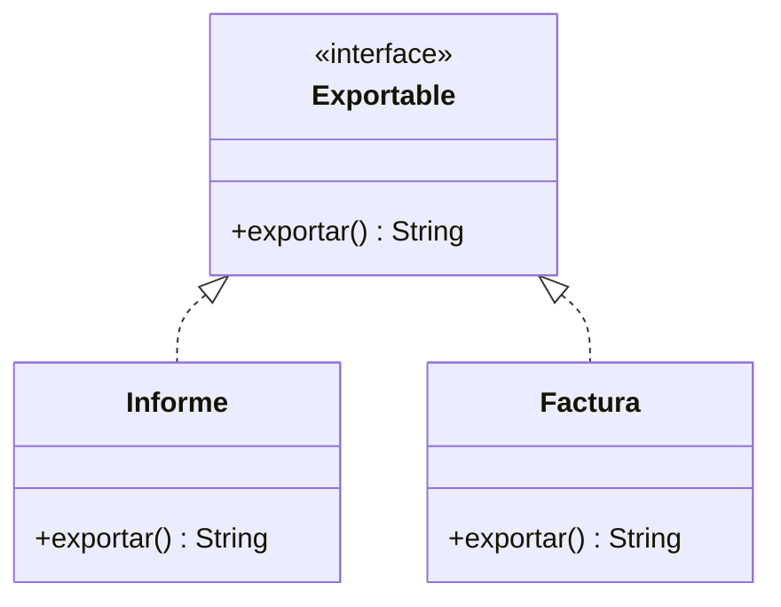

# Interfaces y contratos

> **En una frase:** una interfaz expresa un conjunto de operaciones que un tipo promete ofrecer, sin exigir que sus implementaciones compartan una clase base concreta.

## ¿Qué aprenderás?

- Definir un contrato Java e implementarlo en una clase.
- Usar una misma interfaz con varias implementaciones y componer varios contratos.
- Distinguir interfaces de clases abstractas y comprender `default` y `static`.

## 1. El problema que queremos resolver

Un sistema de exportación necesita guardar datos tanto en archivos como en un servicio remoto. Si el componente que solicita el guardado conoce las clases concretas, queda acoplado a ellas y cambiar el destino puede afectar a muchos lugares. Un contrato permite depender de la operación requerida sin depender de su implementación.

## 2. Definición técnica

Una **interfaz** es un tipo de referencia que declara capacidades y contratos. Una clase la implementa con `implements` y proporciona los métodos abstractos requeridos. Una clase puede implementar varias interfaces, aunque solo puede extender una clase. Una variable declarada con el tipo de la interfaz puede referirse a cualquiera de sus implementaciones compatibles.

Los métodos `default` proporcionan una implementación heredable y sobrescribible; los métodos `static` pertenecen a la interfaz y se invocan con su nombre. No conviertas una interfaz en una colección indiscriminada de utilidades: el contrato debe representar una capacidad coherente.

Una **clase abstracta** puede mantener estado de instancia, constructores y métodos concretos junto con métodos abstractos; sirve cuando las clases relacionadas comparten una base o implementación. Una **interfaz** define capacidades o contratos que pueden atravesar jerarquías distintas.

## 3. Representación visual



`Informe` y `Factura` cumplen el contrato sin necesitar heredar una de otra.

## 4. Ejemplo aplicado

```java
interface Exportable {
    String exportar();

    default String formato() {
        return "texto";
    }

    static boolean esValido(Exportable elemento) {
        return elemento != null && !elemento.exportar().isBlank();
    }
}

interface Imprimible {
    void imprimir();
}

class Informe implements Exportable, Imprimible {
    private final String contenido;

    Informe(String contenido) {
        this.contenido = contenido;
    }

    @Override
    public String exportar() {
        return contenido;
    }

    @Override
    public void imprimir() {
        System.out.println(contenido);
    }
}

class Main {
    public static void main(String[] args) {
        Exportable documento = new Informe("Resumen mensual");
        System.out.println(documento.formato());
        System.out.println(Exportable.esValido(documento));
    }
}
```

La implementación cumple ambos contratos. El cliente puede usar `Exportable` para pedir el contenido sin necesitar conocer `Informe`. El método `formato()` es una implementación `default`; `esValido` se invoca como método `static` de la interfaz. El resultado esperado es `texto` y luego `true`.

Guarda el código en `Main.java`; prueba con `javac Main.java` y `java Main`.

## 5. Cuándo elegir cada abstracción

| Necesidad | Opción que suele encajar |
|---|---|
| Compartir una capacidad entre clases no relacionadas | Interfaz |
| Compartir estado y parte de una implementación entre una familia | Clase abstracta |
| Una clase necesita cumplir varios contratos | Varias interfaces |

Estas son pautas, no una regla mecánica: el contrato y el estado compartido deben guiar la decisión.

## 6. Errores frecuentes

- **Usar una clase abstracta solo para nombrar una capacidad:** una interfaz permite que clases de jerarquías distintas la implementen.
- **Agregar métodos `default` sin criterio:** cada método predeterminado amplía el comportamiento heredado y puede crear conflictos cuando se combinan interfaces.
- **Tratar la interfaz como una clase instanciable:** no se crea con `new`; se crea una instancia de una clase que la implementa.

## 7. Ejercicio práctico

### Enunciado

Define la interfaz `Autenticable` con `autenticar(String clave)` y crea implementaciones para un usuario y un dispositivo. Usa una variable de tipo `Autenticable` para invocar ambas.

<details>
<summary>Mostrar pista y solución propuesta</summary>

```java
interface Autenticable {
    boolean autenticar(String clave);
}

class Usuario implements Autenticable {
    private final String clave;

    Usuario(String clave) { this.clave = clave; }

    @Override
    public boolean autenticar(String entrada) {
        return clave.equals(entrada);
    }
}

class Dispositivo implements Autenticable {
    private final String codigo;

    Dispositivo(String codigo) { this.codigo = codigo; }

    @Override
    public boolean autenticar(String entrada) {
        return codigo.equals(entrada);
    }
}
```

Ambas clases ofrecen la misma operación pública, pero cada una compara su propio dato privado.
</details>

## 8. Resumen y comprensión

- Una interfaz define un contrato, y `implements` declara que una clase lo cumple.
- Una clase implementa varias interfaces y puede ser sustituida por referencias a esos tipos.
- Las clases abstractas son útiles para estado e implementación compartidos; `default` y `static` tienen roles distintos.

1. ¿Qué ventaja da el contrato frente a que un cliente dependa de una clase concreta?
2. ¿Qué diferencias prácticas hay entre `default` y `static`?
3. ¿Cuándo elegirías una clase abstracta en lugar de una interfaz?

## 9. Continúa aprendiendo

- **Requisitos previos:** [Abstracción](/lecciones/abstraccion/), [Polimorfismo](/lecciones/polimorfismo/).
- **Siguiente lección:** [Relaciones entre clases](/lecciones/relaciones-entre-clases/).

## 10. Fuente

- [Oracle. The Java Tutorials: Interfaces](https://docs.oracle.com/javase/tutorial/java/IandI/createinterface.html).
