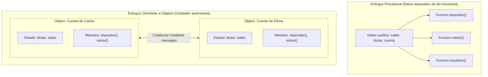

# Introducción a la Programación Orientada a Objetos

> **En una frase:** la Programación Orientada a Objetos es una forma de diseñar software que organiza los datos y las acciones que operan sobre ellos en unidades coherentes llamadas objetos, facilitando la comprensión y evolución de sistemas complejos.

## ¿Qué aprenderás?

Al finalizar esta lección podrás:

- Explicar por qué surge la programación orientada a objetos y qué problemas resuelve frente a enfoques anteriores.
- Distinguir las diferencias conceptuales entre el paradigma procedural y el orientado a objetos.
- Conocer los tres paradigmas de programación más influyentes (procedural, orientado a objetos y funcional).
- Reconocer las partes esenciales de un programa en Java y cómo se ejecuta a través de su método `main`.
- Saber qué herramientas componen el entorno de desarrollo en Java (JDK, JVM e IDEs).

---

## 1. El problema que queremos resolver

Cuando empezamos a programar, solemos escribir instrucciones directas de arriba hacia abajo: declaramos variables sueltas, agregamos condicionales y escribimos funciones que transforman esos datos. Este estilo se conoce como **programación procedural** o estructurada.

Para un script de 30 líneas, este enfoque funciona de maravilla. Sin embargo, ¿qué sucede cuando la aplicación crece a miles de líneas y debe gestionar cientos de elementos?

Imagina un sistema para gestionar las cuentas de un banco:
1. Necesitas guardar el nombre del cliente, su documento, su número de cuenta y su saldo.
2. Si tienes 100 clientes, tendrías que coordinar 100 conjuntos de variables o arreglos paralelos.
3. Cualquier función del programa tiene acceso libre para modificar el saldo directamente, sin pasar por reglas de validación (por ejemplo, permitir un retiro con saldo insuficiente o valores negativos).
4. Si cambia la estructura de los datos (por ejemplo, dividir el nombre en nombre y apellido), tendrás que rastrear y modificar todas las funciones dispersas por el código que toquen esas variables.

A este fenómeno se le conoce como **código frágil y fuertemente acoplado**: los datos viajan desprotegidos por todo el sistema y cualquier cambio en un lugar puede romper partes imprevistas de la aplicación.

La **Programación Orientada a Objetos (POO)** nace para resolver esta dificultad agrupando los datos y las reglas que los gestionan en un único lugar seguro y predecible.

---

## 2. Explicación intuitiva

Piensa en cómo interactúas con los objetos del mundo real. 

Cuando conduces un automóvil, no interactúas con los pistones del motor, la presión del combustible o el voltaje del alternador conectando cables manualmente. El automóvil te expone una **interfaz clara**: un volante, los pedales y una palanca. Al presionar el acelerador, el automóvil internamente sabe cómo aumentar las revoluciones y avanzar.

El automóvil es un **objeto**:
- **Tiene un estado interno:** cantidad de combustible, velocidad actual, encendido o apagado.
- **Tiene comportamientos definidos:** encender, acelerar, frenar, cambiar de marcha.
- **Protege su mecanismo:** no te deja alterar directamente la inyección de combustible con las manos mientras conduces; debes interactuar a través de sus controles seguros.

En la programación orientada a objetos hacemos exactamente lo mismo con los conceptos de nuestro software: en lugar de dejar datos sueltos expuestos a todo el programa, construimos piezas independientes que encapsulan su propia información y ofrecen operaciones claras para comunicarse con las demás.

---

## 3. Definición técnica y paradigmas

Un **paradigma de programación** es un modelo, enfoque o filosofía para estructurar y organizar la solución a un problema mediante código. 

A lo largo de la historia de la computación han destacado tres paradigmas principales:

### Los tres paradigmas principales

1. **Paradigma Procedural (Estructurado):**
   - El programa se organiza como una serie de procedimientos, rutinas o funciones que se ejecutan paso a paso transformando datos que residen en variables separadas.
   - *Fortaleza:* directo, sencillo para programas pequeños o cálculos matemáticos lineales.
   - *Desafío:* al crecer, la separación entre datos y funciones genera dispersión y dificultad de mantenimiento.

2. **Paradigma Orientado a Objetos (POO):**
   - El programa se concibe como una red de objetos que colaboran entre sí enviándose mensajes. Cada objeto es responsable de su propio estado y de las operaciones que realiza.
   - *Fortaleza:* modularidad, reutilización, modelado intuitivo de problemas complejos y facilidad de mantenimiento.
   - *Desafío:* requiere mayor planificación inicial y puede introducir sobrecarga si se utiliza para tareas excesivamente triviales.

3. **Paradigma Funcional:**
   - El programa se estructura evaluando funciones matemáticas puras, evitando cambiar el estado global y priorizando la inmutabilidad de los datos.
   - *Fortaleza:* previene efectos secundarios y facilita el procesamiento concurrente.
   - *Uso común:* procesamiento de flujos de datos, análisis matemático y transformaciones.

> **Nota:** Los lenguajes modernos (incluido Java) son multiparadigma: aunque su núcleo es orientado a objetos, incorporan características funcionales (como expresiones lambda y Streams) para combinar lo mejor de cada enfoque.

---

## 4. Representación visual

Observa la diferencia entre tener datos dispersos accedidos por múltiples funciones frente a agrupar datos y operaciones dentro de objetos autónomos:



**Cómo interpretar el diagrama:**
- En el enfoque procedural, los datos no tienen dueño: cualquier función puede leerlos o modificarlos, lo que dificulta saber quién o cuándo provocó un valor incorrecto.
- En el enfoque orientado a objetos, cada cuenta protege su estado interno y solo cambia cuando se invoca una de sus operaciones autorizadas.

---

## 5. Ejemplo inicial: el problema en el enfoque procedural

Veamos qué ocurre si gestionamos cuentas bancarias únicamente con variables y funciones independientes en Java:

```java
public class EjemploProcedural {

    public static void main(String[] args) {
        // Datos de la cuenta 1
        String titular1 = "Carlos";
        double saldo1 = 1000.0;

        // Datos de la cuenta 2
        String titular2 = "Elena";
        double saldo2 = 500.0;

        // Cualquier parte del código puede modificar variables sin validación
        saldo1 -= 2000.0; // ¡Saldo negativo no controlado!

        System.out.println("Saldo de " + titular1 + ": " + saldo1);
        System.out.println("Saldo de " + titular2 + ": " + saldo2);
    }
}
```

```text
Saldo de Carlos: -1000.0
Saldo de Elena: 500.0
```

### ¿Qué problemas observamos?
1. **Falta de protección de datos:** nadie impidió que el saldo de Carlos se volviera negativo.
2. **Escalabilidad nula:** si necesitamos agregar una tercera cuenta, debemos crear `titular3` y `saldo3`. Con 100 cuentas, el código se vuelve inmanejable.
3. **Lógica duplicada:** si queremos aplicar una regla (por ejemplo: «no permitir retiros mayores al saldo disponible»), tendríamos que recordar escribir ese `if` en cada lugar donde se reste dinero.

---

## 6. Primer vistazo al enfoque orientado a objetos y estructura en Java

En la POO, creamos un **molde** (la clase) que define los datos que tendrá cada cuenta y las operaciones que sabe realizar. Luego creamos **instancias** concretas (los objetos) a partir de ese molde:

```java
// 1. Definición del molde (Clase)
class CuentaBancaria {
    String titular;
    double saldo;

    // Constructor: prepara los datos iniciales al crear la cuenta
    CuentaBancaria(String titularInicial, double saldoInicial) {
        titular = titularInicial;
        saldo = saldoInicial;
    }

    // Comportamiento: depositar dinero aplicando validaciones
    void depositar(double monto) {
        if (monto > 0) {
            saldo += monto;
        }
    }

    // Comportamiento: retirar dinero asegurando saldo suficiente
    void retirar(double monto) {
        if (monto > 0 && saldo >= monto) {
            saldo -= monto;
        } else {
            System.out.println("Operación rechazada: saldo insuficiente en la cuenta de " + titular);
        }
    }

    // Comportamiento: mostrar la información de la cuenta
    void mostrarEstado() {
        System.out.println("Titular: " + titular + " | Saldo: $" + saldo);
    }
}

// 2. Punto de entrada de la aplicación
public class EjemploOrientadoAObjetos {

    public static void main(String[] args) {
        // Creamos dos objetos independientes a partir de la misma clase
        CuentaBancaria cuentaCarlos = new CuentaBancaria("Carlos", 1000.0);
        CuentaBancaria cuentaElena = new CuentaBancaria("Elena", 500.0);

        // Operamos a través de los métodos definidos
        cuentaCarlos.retirar(2000.0); // Se valida y se rechaza
        cuentaCarlos.retirar(200.0);  // Se valida y se aprueba
        cuentaElena.depositar(150.0); // Se incrementa el saldo de Elena

        cuentaCarlos.mostrarEstado();
        cuentaElena.mostrarEstado();
    }
}
```

### Resultado de la ejecución

```text
Operación rechazada: saldo insuficiente en la cuenta de Carlos
Titular: Carlos | Saldo: $800.0
Titular: Elena | Saldo: $650.0
```

### Anatomía mínima de un programa Java

Para comprender el código anterior, recordemos los tres elementos fundamentales que todo programa Java posee:

1. **La clase contenedora (`public class EjemploOrientadoAObjetos`):** en Java, todo código ejecutable reside dentro de una clase. El nombre del archivo debe coincidir exactamente con el de la clase pública (`EjemploOrientadoAObjetos.java`).
2. **El método `main`:** es el punto de entrada que la máquina virtual busca para iniciar la ejecución del programa:
   ```java
   public static void main(String[] args)
   ```
   - `public`: accesible desde cualquier punto del entorno.
   - `static`: pertenece a la clase y no requiere crear una instancia previa para ejecutarse.
   - `void`: no devuelve ningún valor al finalizar.
   - `String[] args`: arreglo de cadenas que permite recibir argumentos desde la línea de comandos.
3. **Instanciación con `new`:** el operador `new CuentaBancaria(...)` reserva memoria para un nuevo objeto y ejecuta su constructor.

---

## 7. Comparación entre enfoques

| Criterio | Paradigma Procedural | Paradigma Orientado a Objetos |
|---|---|---|
| **Eje central** | Funciones y algoritmos secuenciales. | Objetos que encapsulan estado y comportamiento. |
| **Organización de los datos** | Variables dispersas o arreglos globales/locales. | Atributos protegidos dentro de cada instancia. |
| **Protección del estado** | Baja: cualquier función puede alterar los datos. | Alta: las modificaciones pasan por métodos controlados. |
| **Reutilización** | Reutiliza funciones individuales. | Reutiliza clases completas y modelos de dominio. |
| **Mantenimiento en proyectos grandes** | Complejo: cambios en datos afectan múltiples funciones. | Modular: los cambios internos de un objeto no rompen a otros. |

---

## 8. ¿Cuándo utilizar la POO y cuándo tener cuidado?

### Es especialmente útil cuando:
- El software modela entidades del mundo real o del negocio con reglas específicas (usuarios, pedidos, productos, facturas).
- El sistema cuenta con múltiples elementos que comparten estructura pero tienen datos independientes.
- El proyecto crecerá en el tiempo y será mantenido por un equipo de desarrolladores.
- Se requiere que el código sea testeable de forma modular.

### Conviene tener precaución cuando:
- La tarea a resolver es un script muy pequeño y puntual (por ejemplo, renombrar 5 archivos en disco o calcular un promedio único).
- Se diseñan jerarquías de clases artificiales antes de comprender el problema real (sobreingeniería).

---

## 9. Preparación del entorno de desarrollo en Java

Para escribir y ejecutar tus programas en Java necesitas dos herramientas fundamentales:

1. **JDK (Java Development Kit):**
   - Es el kit de herramientas oficial de desarrollo. Incluye el compilador (`javac`), las librerías base de Java y la máquina virtual (**JVM**, *Java Virtual Machine*) que ejecuta el código compilado (*bytecode*).
   - Se recomienda utilizar una versión moderna LTS de Java (como Java 17 o Java 21).

2. **Un Entorno de Desarrollo Integrado (IDE):**
   - Aunque se puede programar en un bloc de notas y compilar desde la terminal con `javac`, un IDE facilita enormemente el aprendizaje detectando errores en tiempo real y ofreciendo herramientas de depuración y ejecución con un clic.
   - Opciones recomendadas:
     - **IntelliJ IDEA (Community Edition):** moderno, potente y estándar en la industria.
     - **Apache NetBeans:** muy utilizado en entornos educativos universitarios.
     - **Visual Studio Code:** ligero y extensible mediante el *Extension Pack for Java*.

---

## 10. Errores frecuentes al iniciarse en la POO

### 1. Tratar a las clases como simples contenedores de funciones globales
**Qué sucede:** crear clases repletas de métodos `static` y variables globales, programando en estilo procedural pero dentro de un archivo `.java`.  
**Cómo evitarlo:** recuerda que una clase debe representar un concepto con identidad y estado propio.

### 2. Olvidar que cada objeto mantiene su propia copia de datos
**Qué sucede:** modificar el saldo de `cuentaCarlos` y esperar que mágicamente afecte a `cuentaElena`.  
**Cómo evitarlo:** cada vez que utilizas `new`, se crea un espacio de memoria independiente para ese objeto en particular.

### 3. Crear clases complejas para datos que no requieren comportamiento
**Qué sucede:** crear una jerarquía de 5 clases para un cálculo que requería dos operaciones matemáticas sencillas.  
**Cómo evitarlo:** aplica el principio de simplicidad; introduce clases cuando haya un concepto que justifique agrupar datos y operaciones.

---

## 11. Ejercicio práctico

### Enunciado

Diseña una clase llamada `Termometro` que modele un instrumento para medir temperatura en grados Celsius.

**Requisitos:**
1. Debe guardar la temperatura actual como un valor numérico decimal (`double`).
2. Debe inicializarse con una temperatura inicial a través de su constructor.
3. Debe incluir un método `ajustarTemperatura(double nuevaTemperatura)` que solo acepte valores físicamente posibles (por ejemplo, temperaturas no inferiores al cero absoluto: `-273.15 °C`). Si el valor es menor, debe mostrar un mensaje de aviso y no modificar la temperatura.
4. Debe incluir un método `mostrarLectura()` que imprima la temperatura actual en consola.
5. En una clase ejecutable con método `main`, crea dos termómetros (uno para el interior y otro para el exterior), actualiza sus valores y muestra sus lecturas.

### Pistas

<details>
<summary>Mostrar pistas</summary>

- Declara un atributo `double temperatura;` dentro de la clase `Termometro`.
- El constructor debe recibir `double temperaturaInicial` y asignarlo a `temperatura`.
- En `ajustarTemperatura`, usa un condicional `if (nuevaTemperatura >= -273.15)` para validar el valor antes de guardarlo.

</details>

### Solución propuesta

<details>
<summary>Mostrar solución y explicación</summary>

```java
// Clase que modela el termómetro
class Termometro {
    double temperatura;

    Termometro(double temperaturaInicial) {
        if (temperaturaInicial >= -273.15) {
            temperatura = temperaturaInicial;
        } else {
            temperatura = 0.0;
            System.out.println("Temperatura inicial no válida. Se asigna 0.0 °C.");
        }
    }

    void ajustarTemperatura(double nuevaTemperatura) {
        if (nuevaTemperatura >= -273.15) {
            temperatura = nuevaTemperatura;
        } else {
            System.out.println("Error: " + nuevaTemperatura + " °C está por debajo del cero absoluto (-273.15 °C).");
        }
    }

    void mostrarLectura(String ubicacion) {
        System.out.println("Termómetro [" + ubicacion + "]: " + temperatura + " °C");
    }
}

// Punto de entrada del programa
public class PruebaTermometro {

    public static void main(String[] args) {
        Termometro termometroInterior = new Termometro(21.5);
        Termometro termometroExterior = new Termometro(14.0);

        // Modificamos temperaturas
        termometroInterior.ajustarTemperatura(23.0);
        termometroExterior.ajustarTemperatura(-300.0); // Intento no válido

        // Mostramos lecturas finales
        termometroInterior.mostrarLectura("Sala");
        termometroExterior.mostrarLectura("Patio");
    }
}
```

**Resultado esperado:**
```text
Error: -300.0 °C está por debajo del cero absoluto (-273.15 °C).
Termómetro [Sala]: 23.0 °C
Termómetro [Patio]: 14.0 °C
```

**Explicación:**  
La clase `Termometro` protege el atributo `temperatura` garantizando que no contenga valores físicamente imposibles. Cada objeto (`termometroInterior` y `termometroExterior`) conserva su propio estado de forma totalmente independiente.

</details>

---

## 12. Resumen de la lección

- **Propósito:** la POO nace para superar las limitaciones del software procedural cuando crece, agrupando datos y operaciones en unidades coherentes y protegidas.
- **Concepto clave:** un objeto une estado (datos) y comportamiento (métodos), interactuando con otros objetos mediante llamadas a sus métodos.
- **Java como lenguaje:** todo programa Java se organiza en clases, requiere un método `main` como punto de partida y se ejecuta sobre la Máquina Virtual de Java (JVM).
- **Herramientas base:** para desarrollar en Java se requiere el JDK (compilador y JVM) y preferiblemente un IDE como IntelliJ IDEA, NetBeans o VS Code.

---

## 13. Comprueba tu comprensión

Responde estas preguntas para evaluar lo aprendido en esta lección:

1. ¿Cuál es el principal problema de mantener los datos separados de las funciones en aplicaciones que crecen en tamaño?
2. Si creas dos cuentas bancarias usando `new CuentaBancaria(...)`, ¿por qué retirar dinero de una no altera el saldo de la otra?
3. ¿Cuál es la función del método `public static void main(String[] args)` en una aplicación Java?
4. ¿En qué se diferencia el rol del compilador `javac` del rol de la JVM al ejecutar un programa en Java?

---

## 14. Continúa aprendiendo

Ahora que comprendes qué motiva a la POO y cómo se estructura un programa básico en Java, el siguiente paso es profundizar en cómo se definen las clases y cómo interactúan los objetos en memoria:

- **Siguiente lección recomendada:** [Clases y objetos](/lecciones/clases-objetos/) — donde aprenderás a diseñar tu primera clase en Java (`Pedido`), gestionar el estado independiente de múltiples objetos y usar constructores.
- **Categoría principal:** [Fundamentos de POO](/categorias/fundamentos-poo/)

---

## 15. Fuentes y lecturas recomendadas

- Oracle. *The Java Tutorials: Trails Covering the Basics — Object-Oriented Programming Concepts*. [docs.oracle.com/javase/tutorial/java/concepts/](https://docs.oracle.com/javase/tutorial/java/concepts/)
- Cay S. Horstmann. *Core Java Volume I: Fundamentals* (12th Edition). Pearson, 2022. Capítulo 4: «Objects and Classes».
- Joshua Bloch. *Effective Java* (3rd Edition). Addison-Wesley, 2018. Capítulo 4: «Classes and Interfaces».
