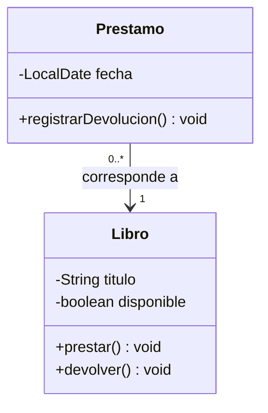
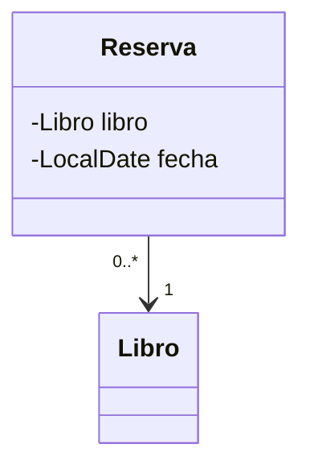

# Modelado y diseño con UML

> **En una frase:** UML es un lenguaje visual para comunicar y analizar modelos de software; un diagrama describe decisiones, pero no reemplaza los requisitos ni el código.

## ¿Qué aprenderás?

- Leer notación de clases y relaciones.
- Elegir entre diagramas de clases, objetos y secuencia.
- Traducir un modelo pequeño a código sin confundir el diagrama con una implementación completa.

## 1. El problema que queremos resolver

Antes de implementar una biblioteca, conviene acordar qué información guarda un libro, cómo se relaciona con un préstamo y qué operación registra su devolución. Un dibujo compartido ayuda a detectar ambigüedades temprano y discutir responsabilidades con el equipo.

## 2. Elementos de un diagrama de clases

Una clase suele representarse con nombre, atributos y operaciones. La notación de visibilidad habitual es `+` público, `-` privado, `#` protegido y `~` visibilidad de paquete. Las relaciones pueden expresar herencia, realización de una interfaz, asociación, dependencia y relaciones todo-parte. Los extremos pueden anotar multiplicidad, por ejemplo `1` o `0..*`.

Un **diagrama de clases** presenta tipos y relaciones estáticas; un **diagrama de objetos** muestra instancias concretas en un momento; un **diagrama de secuencia** muestra mensajes ordenados en el tiempo. Selecciona el diagrama que responde a la pregunta del diseño, no todos a la vez.

## 3. Ejemplo: una biblioteca



Cada préstamo corresponde a un libro; un libro puede aparecer en varios préstamos históricos. El diagrama no define por sí solo qué sucede si se intenta prestar un libro no disponible: esa regla debe especificarse.

## 4. Del modelo a Java

```java
import java.time.LocalDate;

class Libro {
    private final String titulo;
    private boolean disponible = true;

    Libro(String titulo) {
        if (titulo == null || titulo.isBlank()) {
            throw new IllegalArgumentException("El título es obligatorio");
        }
        this.titulo = titulo;
    }

    public void prestar() {
        if (!disponible) {
            throw new IllegalStateException("El libro ya está prestado");
        }
        disponible = false;
    }

    public void devolver() {
        disponible = true;
    }
}

class Prestamo {
    private final Libro libro;
    private final LocalDate fecha;

    Prestamo(Libro libro, LocalDate fecha) {
        if (libro == null || fecha == null) {
            throw new IllegalArgumentException("Libro y fecha son obligatorios");
        }
        this.libro = libro;
        this.fecha = fecha;
    }

    public void registrarDevolucion() {
        libro.devolver();
    }
}
```

El campo `libro` implementa una asociación navegable desde `Prestamo`. La fecha usa `LocalDate`, una clase de la biblioteca estándar. Para convertir el ejemplo en aplicación ejecutable, una clase `Main` puede construir un `Libro`, prestarlo, crear el `Prestamo` con `LocalDate.now()` y registrar su devolución.

## 5. De los requisitos al diagrama

1. Identifica sustantivos y conceptos relevantes del dominio, sin convertir automáticamente cada sustantivo en una clase.
2. Determina qué información debe mantener cada objeto y qué operaciones protegen sus reglas.
3. Decide relaciones y multiplicidades a partir de requisitos verificables.
4. Revisa si el modelo permite explicar casos válidos e inválidos antes de traducirlo a código.

## 6. Límites y errores frecuentes

- **Diseñar un diagrama enorme antes de conocer requisitos:** comienza con el escenario que necesitas resolver.
- **Leer una flecha como código ejecutable:** la notación resume intención; el lenguaje y la implementación tienen sus propias reglas.
- **Confundir cardinalidad con validación:** si un préstamo debe referir un libro, el constructor también debe impedir `null`.

## 7. Ejercicio y solución orientativa

### Enunciado

Modela una `Reserva` que siempre corresponde a un `Libro` y tiene una fecha. Añade un diagrama con la multiplicidad y los campos privados.

<details>
<summary>Mostrar solución orientativa</summary>



La reserva puede mantener una referencia obligatoria a un libro y una fecha validada. La multiplicidad `1` en el extremo Libro indica que cada reserva está vinculada a uno.
</details>

## 8. Resumen y comprensión

- UML comunica estructura y comportamiento desde distintas perspectivas.
- La visibilidad y multiplicidad ayudan a precisar un modelo.
- Verifica que las reglas representadas se reflejen también en la implementación.

1. ¿Qué pregunta responde mejor un diagrama de secuencia que uno de clases?
2. ¿Qué significa `0..*`?
3. ¿Por qué un diagrama que muestra una referencia obligatoria no valida por sí solo el constructor?

## 9. Continúa aprendiendo

- **Requisito previo:** [Relaciones entre clases](/lecciones/relaciones-entre-clases/).
- **Siguiente lección:** [Organización y modularidad](/lecciones/organizacion-y-modularidad/).

## 10. Fuente

- [OMG UML, versión 2.5.1](https://www.omg.org/spec/UML/2.5.1).
