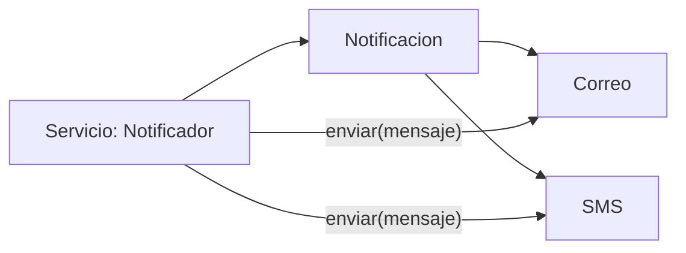

# Polimorfismo

> **En una frase:** el polimorfismo permite invocar una operación mediante un tipo común y dejar que el objeto concreto determine cuál implementación se ejecuta.

## ¿Qué aprenderás?

- Usar una referencia de supertipo para manejar objetos de distintas subclases.
- Diferenciar el despacho dinámico de la selección de una sobrecarga.
- Entender cuándo son necesarios `instanceof` y el *casting*.

## 1. El problema que queremos resolver

Una aplicación puede enviar notificaciones por correo y por SMS. Si el código que envía notificaciones debe preguntar el tipo concreto en cada caso, cada nueva modalidad obliga a modificar el flujo central. Un comportamiento común permite que cada implementación resuelva su propio envío.

## 2. Intuición y definición técnica

Un mismo control remoto puede ofrecer el botón «reproducir» para distintos dispositivos; cada aparato responde según su tipo. En Java, una variable puede tener como tipo declarado una clase base o interfaz y referirse a una instancia de una implementación compatible. Al llamar un método de instancia sobrescrito, la JVM selecciona la implementación según la clase real del objeto: esto es **despacho dinámico**.

La **sobrecarga** (*overloading*) declara varios métodos del mismo nombre con distintas listas de parámetros; el compilador elige la firma según los tipos estáticos de los argumentos. La **sobrescritura** (*overriding*) reemplaza una implementación heredada compatible y participa en el despacho dinámico. No son el mismo mecanismo.

El *casting* explícito puede ser necesario para acceder a operaciones exclusivas de un subtipo. Una conversión incorrecta puede producir `ClassCastException`; `instanceof` permite comprobar compatibilidad antes de convertir. Si abundan estas comprobaciones, probablemente falta una operación común bien diseñada.

## 3. Representación visual



El servicio depende del tipo común y no necesita decidir si cada objeto es correo o SMS.

## 4. Ejemplo en Java

```java
interface Notificacion {
    String enviar(String mensaje);
}

class Correo implements Notificacion {
    @Override
    public String enviar(String mensaje) {
        return "Correo enviado: " + mensaje;
    }
}

class Sms implements Notificacion {
    @Override
    public String enviar(String mensaje) {
        return "SMS enviado: " + mensaje;
    }
}

public class Main {
    public static void main(String[] args) {
        Notificacion[] notificaciones = {new Correo(), new Sms()};
        for (Notificacion notificacion : notificaciones) {
            System.out.println(notificacion.enviar("Tu pedido está listo"));
        }
    }
}
```

La salida esperada contiene primero `Correo enviado: Tu pedido está listo` y después `SMS enviado: Tu pedido está listo`. Aunque la variable del bucle es siempre `Notificacion`, se ejecuta la implementación del objeto real.

Guarda el código como `Main.java`; compila con `javac Main.java` y ejecuta `java Main`.

### Sobrecarga no es despacho dinámico

```java
class Impresor {
    void imprimir(Object valor) { System.out.println("Object"); }
    void imprimir(String valor) { System.out.println("String"); }
}
```

La llamada `imprimir("hola")` selecciona la sobrecarga `String` al compilar. En cambio, si una subclase sobrescribe un método de instancia y se invoca a través de una referencia base, la implementación se decide en tiempo de ejecución.

## 5. Uso prudente de tipos y conversiones

Prefiere invocar el comportamiento común sin preguntar por cada subtipo. Cuando una operación específica sí requiera un subtipo, comprueba antes:

```java
if (objeto instanceof Sms sms) {
    System.out.println(sms.enviar("Aviso urgente"));
}
```

La forma con patrón de `instanceof` está disponible en Java moderno. No es necesaria para el ejemplo principal. Una referencia `Notificacion` puede guardar un `Correo`, pero no permite llamar directamente métodos que solo declare `Correo`; su tipo declarado limita las operaciones disponibles en compilación.

## 6. Errores frecuentes

- **Confundir subtipo y tipo concreto:** el tipo de referencia controla qué miembros se pueden invocar; la clase real determina la implementación sobrescrita.
- **Usar `instanceof` para cada caso:** una larga cadena de comprobaciones suele señalar que conviene polimorfismo.
- **Confundir sobrecarga y sobrescritura:** la primera se resuelve por la firma durante compilación; la segunda puede resolverse dinámicamente.

## 7. Ejercicio práctico

### Enunciado

Define una interfaz `Figura` con `calcularArea()` y dos implementaciones: `Rectangulo` y `Circulo`. Recorre ambas mediante un arreglo `Figura[]`.

<details>
<summary>Mostrar pistas y solución propuesta</summary>

Haz que cada clase implemente la misma operación; valida que las dimensiones sean positivas.

```java
interface Figura {
    double calcularArea();
}

class Rectangulo implements Figura {
    private final double ancho;
    private final double alto;

    Rectangulo(double ancho, double alto) {
        if (ancho <= 0 || alto <= 0) {
            throw new IllegalArgumentException("Las dimensiones deben ser positivas");
        }
        this.ancho = ancho;
        this.alto = alto;
    }

    public double calcularArea() {
        return ancho * alto;
    }
}

class Circulo implements Figura {
    private final double radio;

    Circulo(double radio) {
        if (radio <= 0) {
            throw new IllegalArgumentException("El radio debe ser positivo");
        }
        this.radio = radio;
    }

    public double calcularArea() {
        return Math.PI * radio * radio;
    }
}

class Main {
    public static void main(String[] args) {
        Figura[] figuras = {new Rectangulo(3, 4), new Circulo(2)};
        for (Figura figura : figuras) {
            System.out.println(figura.calcularArea());
        }
    }
}
```

El bucle solo conoce `Figura`; cada área se calcula con la fórmula propia de su clase.
</details>

## 8. Resumen y comprensión

- El polimorfismo de subtipos desacopla al código cliente de las clases concretas.
- El despacho dinámico elige métodos de instancia sobrescritos según el objeto real.
- La sobrecarga se selecciona por firma en compilación; el *casting* debe justificarse.

1. ¿Qué determina qué método sobrescrito se ejecuta?
2. ¿Por qué una referencia de tipo `Figura` no puede llamar un método exclusivo de `Circulo`?
3. ¿Qué cambio necesitarías para añadir una tercera figura sin editar el bucle?

## 9. Continúa aprendiendo

- **Requisito previo:** [Herencia](/lecciones/herencia/).
- **Siguiente lección:** [Interfaces y contratos](/lecciones/interfaces-y-contratos/).

## 10. Fuente

- [Oracle. The Java Tutorials: Polymorphism](https://docs.oracle.com/javase/tutorial/java/IandI/polymorphism.html).
