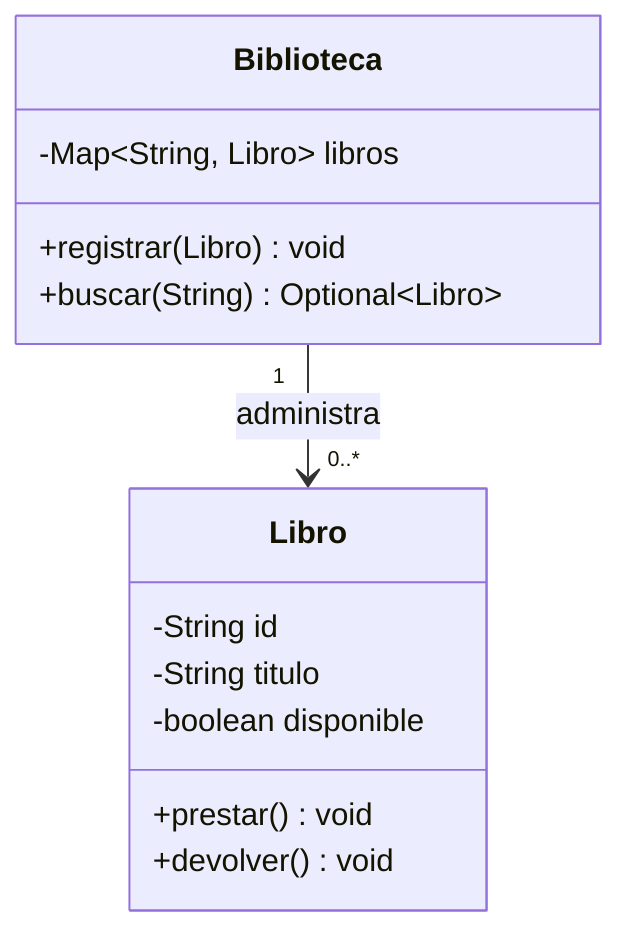

# Proyecto integrador: gestión de préstamos de biblioteca

> **En una frase:** este proyecto reúne los conceptos del curso en una aplicación pequeña cuya prioridad es modelar reglas reales, no demostrar cada característica de Java.

## ¿Qué construirás?

Una aplicación de consola que administra libros y préstamos. Comienza por las reglas mínimas; una interfaz gráfica, base de datos o jerarquía de clases no son requisitos de este ejercicio.

## 1. Requisitos funcionales

1. Registrar libros con identificador único y título no vacío.
2. Consultar si un libro está disponible.
3. Prestar un libro disponible y rechazar un segundo préstamo activo.
4. Registrar la devolución del libro prestado.
5. Buscar libros por identificador y mostrar su estado.

Define qué hacer cuando un identificador ya existe, cuando no hay coincidencias y cuando se intenta devolver un libro disponible. Expresa cada decisión como una regla verificable.

## 2. Modelo inicial



La biblioteca administra una colección de libros; cada libro protege su estado. La flecha muestra navegabilidad desde la biblioteca hacia los libros y no establece por sí sola su ciclo de vida.

## 3. Plan de implementación

1. **Modela:** enumera los datos y reglas de `Libro`; no expongas campos.
2. **Implementa el comportamiento:** `prestar()` cambia disponibilidad solo si la regla lo permite; `devolver()` define qué ocurre ante una devolución inválida.
3. **Añade el catálogo:** una colección indexada por identificador facilita búsquedas; valida duplicados.
4. **Crea el flujo de consola:** mantén la interacción en una clase separada del modelo.
5. **Añade pruebas:** cubre el préstamo válido, préstamo repetido, devolución y búsqueda de identificador inexistente.
6. **Refactoriza:** extrae responsabilidades solo cuando una dificultad concreta lo justifique.

## 4. Ejemplo de una regla del dominio

```java
class Libro {
    private final String id;
    private final String titulo;
    private boolean disponible = true;

    Libro(String id, String titulo) {
        if (id == null || id.isBlank() || titulo == null || titulo.isBlank()) {
            throw new IllegalArgumentException("ID y título son obligatorios");
        }
        this.id = id;
        this.titulo = titulo;
    }

    public void prestar() {
        if (!disponible) {
            throw new IllegalStateException("El libro ya está prestado");
        }
        disponible = false;
    }

    public void devolver() {
        if (disponible) {
            throw new IllegalStateException("El libro no tiene un préstamo activo");
        }
        disponible = true;
    }

    public boolean estaDisponible() {
        return disponible;
    }

    public String getId() { return id; }
    public String getTitulo() { return titulo; }
}
```

Los métodos preservan la regla en vez de exponer un `setDisponible` que permitiría saltarse el ciclo de préstamo. Completa la biblioteca y las pruebas como parte del ejercicio; el fragmento no es una aplicación terminada.

## 5. Pruebas y criterios de aceptación

- Un libro nuevo comienza disponible.
- Prestarlo lo deja no disponible.
- Intentar prestarlo otra vez falla sin alterar el estado.
- Devolverlo restablece la disponibilidad.
- Rechazar una devolución sin préstamo activo.
- La biblioteca no registra dos libros con el mismo ID.
- Una búsqueda ausente se representa claramente y no provoca un `NullPointerException`.

Puedes usar JUnit Jupiter si está configurado en el proyecto. Separa las pruebas de reglas del modelo de las pruebas de interacción de consola.

## 6. Decisiones de diseño

- **Herencia e interfaces:** inclúyelas solo si el dominio tiene variantes que comparten un contrato con comportamiento distinto.
- **Colecciones:** selecciona una estructura a partir de las operaciones requeridas; un `Map` es adecuado si las búsquedas por ID dominan.
- **Excepciones:** comunica errores de operación; el límite de consola decide cómo mostrarlos.
- **Patrones:** no agregues Strategy, Factory o Observer si no resuelven una variación concreta.
- **Persistencia:** queda fuera del alcance inicial; puede añadirse después con un contrato si aparece ese requisito.

## 7. Entrega y revisión

Entrega el código fuente, un diagrama actualizado, instrucciones de ejecución y pruebas. Revisa nombres, acceso, duplicación, casos límite y que cada clase tenga un propósito claro. Escribe qué regla no está cubierta si una funcionalidad queda pendiente; no presentes una implementación parcial como completa.

### Preguntas de reflexión

1. ¿Qué regla pertenece a `Libro` y cuál a `Biblioteca`?
2. ¿Qué estructura de colección elegiste y qué operación motivó la decisión?
3. ¿Qué cambio futuro justificaría introducir una interfaz o patrón?

## 8. Resumen

- Parte de requisitos verificables y responsabilidades, no de una lista obligatoria de patrones.
- Protege el estado en las clases del dominio y prueba las reglas en sus límites.
- Mantén simple el alcance y extiende el diseño cuando un requisito lo necesite.

## 9. Continúa aprendiendo

- **Requisitos previos:** [Modelado con UML](/lecciones/modelado-con-uml/), [Pruebas unitarias](/lecciones/pruebas-unitarias/).
- **Repaso:** [Principios de buen diseño](/lecciones/principios-de-buen-diseno/), [Refactorización y calidad](/lecciones/refactorizacion-y-calidad/).

## 10. Fuente

- [Oracle. The Java Tutorials: Object-Oriented Programming Concepts](https://docs.oracle.com/javase/tutorial/java/concepts/).
