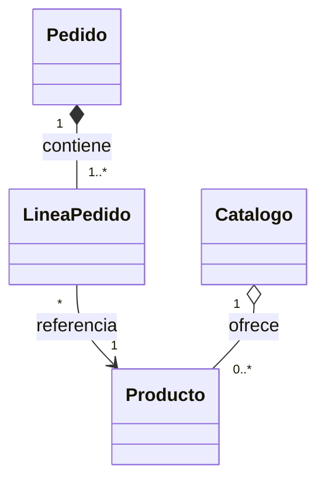

# Relaciones entre clases y objetos

> **En una frase:** las relaciones describen cómo colaboran los objetos y qué conoce, contiene o utiliza cada uno.

## ¿Qué aprenderás?

- Distinguir asociación, dependencia, agregación y composición.
- Interpretar multiplicidad y navegabilidad.
- Elegir una relación a partir del ciclo de vida y las responsabilidades del dominio.

## 1. El problema que queremos resolver

Un pedido contiene productos y es procesado por un servicio. Si el modelo omite esas relaciones o las representa todas como «un objeto dentro de otro», resulta difícil saber quién crea los elementos, quién los conserva y qué responsabilidades tiene cada clase.

## 2. Definiciones y diferencias

- **Asociación:** vínculo estructural entre objetos que pueden conocerse o colaborar. Puede expresarse con una referencia o una colección.
- **Dependencia:** un elemento usa otro de forma temporal, por ejemplo como parámetro local de un método. Un cambio en el proveedor puede afectar al cliente.
- **Agregación:** asociación todo-parte débil; la parte puede existir independientemente del agregado y puede compartirse. UML la representa con un rombo blanco. El lenguaje Java no impone semántica especial de agregación.
- **Composición:** relación todo-parte más fuerte; el compuesto controla la pertenencia y el ciclo de vida de la parte. UML usa un rombo negro. Java tampoco la garantiza automáticamente: el diseño del código debe sostenerla.

La diferencia entre asociación, agregación y composición no se deduce solo de que un campo sea una referencia: importa el significado del dominio, la propiedad y el ciclo de vida.

La **multiplicidad** indica cuántas instancias participan: `1` significa exactamente una; `0..1`, ninguna o una; `*` o `0..*`, cero o muchas; `1..*`, una o más. La **navegabilidad** expresa qué extremo puede acceder al otro; si no se dibuja dirección, la convención del diagrama debe aclararse.

## 3. Representación UML



En el ejemplo, las líneas pertenecen al pedido; una línea referencia un producto; el catálogo agrega productos que pueden existir sin ese catálogo. Es un modelo ilustrativo: el ciclo de vida real depende de los requisitos.

## 4. Ejemplo en Java

```java
import java.util.ArrayList;
import java.util.List;

class Producto {
    private final String nombre;

    Producto(String nombre) {
        if (nombre == null || nombre.isBlank()) {
            throw new IllegalArgumentException("El nombre es obligatorio");
        }
        this.nombre = nombre;
    }

    public String getNombre() {
        return nombre;
    }
}

class Pedido {
    private final List<Producto> productos = new ArrayList<>();

    public void agregar(Producto producto) {
        if (producto == null) {
            throw new IllegalArgumentException("El producto es obligatorio");
        }
        productos.add(producto);
    }

    public int cantidadDeProductos() {
        return productos.size();
    }
}

class Main {
    public static void main(String[] args) {
        Producto libro = new Producto("Libro");
        Pedido pedido = new Pedido();
        pedido.agregar(libro);
        System.out.println(pedido.cantidadDeProductos());
        System.out.println(libro.getNombre());
    }
}
```

El pedido mantiene una colección de referencias a productos: hay una asociación con multiplicidad de cero a muchos. El hecho de que el pedido conserve una referencia no demuestra por sí mismo composición; el producto se creó por separado y puede seguir existiendo fuera del pedido. La salida esperada es `1` y `Libro`.

Guarda el ejemplo como `Main.java`, compílalo con `javac Main.java` y ejecútalo con `java Main`.

## 5. Asignar responsabilidades

Pregunta qué objeto posee la información necesaria y quién debe mantener sus reglas. Evita tanto los objetos que conocen todo el sistema como las clases de datos que obligan a otros componentes a manipular su estado directamente. Empieza con la relación mínima necesaria y amplíala cuando un requisito lo justifique.

## 6. Errores frecuentes

- **Llamar composición a cualquier campo:** una referencia no define por sí sola propiedad ni ciclo de vida.
- **Usar una dependencia como estado permanente:** si el objeto debe recordar al colaborador entre operaciones, una asociación explícita puede representar mejor el vínculo.
- **Omitir multiplicidad:** aclara si una relación admite cero, uno o varios elementos.

## 7. Ejercicio práctico

### Enunciado

Modela un equipo de trabajo que tiene varios empleados. Indica si la relación es asociación, agregación o composición y justifica qué sucede con un empleado si se elimina el equipo.

<details>
<summary>Mostrar pista y solución propuesta</summary>

Si empleados pueden existir, cambiar de equipo o compartirse en otros registros, modela una asociación o agregación, no composición. En Java, un `Equipo` podría guardar una `List<Empleado>` y validar los elementos añadidos; no debería crear ni destruir conceptualmente al empleado.
</details>

## 8. Resumen y comprensión

- Asociación describe un vínculo; dependencia, un uso; agregación y composición precisan significados todo-parte distintos.
- Multiplicidad expresa cantidades; navegabilidad, acceso desde un extremo.
- UML ayuda a comunicar decisiones, pero el diagrama no sustituye las reglas del dominio ni las implementa por sí solo.

1. ¿Qué dato del dominio permite distinguir agregación de composición?
2. ¿Qué significa `0..1` en un extremo de asociación?
3. ¿Por qué no basta con observar un campo Java para afirmar que existe composición?

## 9. Continúa aprendiendo

- **Requisito previo:** [Clases y objetos](/lecciones/clases-objetos/).
- **Siguiente lección:** [Composición y diseño](/lecciones/composicion-y-diseno/).
- **Tema relacionado:** [Modelado con UML](/lecciones/modelado-con-uml/).

## 10. Fuente

- [Object Management Group. OMG Unified Modeling Language (OMG UML), Version 2.5.1](https://www.omg.org/spec/UML/2.5.1).
